# The React developer guide

Build **Cold storage**, a dashboard that helps you spot warm temperature probes.
Start with a working React screen and local buttons. Then run Drasi, send real
changes with curl, and let continuous queries maintain the answers. Finish with
notifications, authentication, and a deployable application.

You need basic React and TypeScript knowledge and a terminal. **Part I needs no
backend.** Part II includes a released-backend launcher for macOS Apple Silicon
and Linux x64; it downloads Server and signed plugins, without a Rust build.

<a id="understand-what-runs-where"></a>
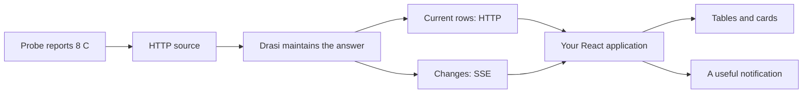

*Figure 1. The backend maintains query results; React presents and responds to them.*

When `probe-1001` warms from 3 C to 8 C, its row changes in `north-room`.
It also **enters** `warm-probes`, whose query selects temperatures of at least
8 C. A snapshot supplies the current rows; server-sent events (SSE) carry later
changes over a long-lived HTTP response. You will observe both kinds of change.

## Contents

**Part I - Build a useful screen, without a backend**

1. [Run your first screen](#1-run-your-first-screen)
2. [Control sorting and presentation](#2-control-sorting-and-presentation)
3. [Add actions and a review dialog](#3-add-actions-and-a-review-dialog)
4. [Theme an accessible screen](#4-theme-an-accessible-screen)

**Part II - Work with real Drasi results**

5. [Run the Cold storage backend](#5-run-the-cold-storage-backend)
6. [Connect your first live table](#6-connect-your-first-live-table)
7. [Preserve identity through deletes](#7-preserve-identity-through-deletes)
8. [Watch rows enter and leave an answer](#8-watch-rows-enter-and-leave-an-answer)
9. [Share one query across presentations](#9-share-one-query-across-presentations)
10. [Keep failures and recovery visible](#10-keep-failures-and-recovery-visible)
11. [React to change in application code](#11-react-to-change-in-application-code)

**Part III - Own the application**

12. [Authenticate both transports](#12-authenticate-both-transports)
13. [Use SSR and Next client boundaries](#13-use-ssr-and-next-client-boundaries)
14. [Test observable behavior](#14-test-observable-behavior)
15. [Diagnose by layer](#15-diagnose-by-layer)
16. [Deploy the complete application](#16-deploy-the-complete-application)
17. [Capstone: a Cold storage dashboard](#17-capstone-a-cold-storage-dashboard)

[Appendix A: Vocabulary](#appendix-a-vocabulary) |
[Appendix B: Imports and reference](#appendix-b-imports-and-reference) |
[Appendix C: Installation after publication](#appendix-c-installation-after-publication) |
[Appendix D: Bring your own gateway](#appendix-d-bring-your-own-gateway) |
[Source notes](#source-notes)

<a id="part-i---build-a-useful-screen"></a>
## Part I - Build a useful screen, without a backend

### 1. Run your first screen

**Goal:** display four probes, warm one, and reset the screen.
**Prerequisites:** a terminal, Git, and one of the tested toolchains:
Node **22.20.0** or **24.19.0**, with npm **11.17.0**.
22.20.0 is the lowest Node version exercised by this book's qualification;
24.19.0 is the maintainer pin. The browser packages themselves impose no Node
engine requirement. The pinned Vite tooling has its own Node requirement.[^tools]

<a id="get-installable-artifacts"></a>
#### Install the controls

**Current availability:** neither the npm packages nor GitHub preview downloads
are published yet. GitHub prerelease downloads are the intended lighter route:
they will contain the same three qualified archives, a source identity, and
checksums. Until a prerelease is actually listed on the
[releases page](https://github.com/drasi-project/drasi-ui/releases), use the
working source-build route below. There is no preview URL to guess.

In a directory without an existing `drasi-ui` or `cold-storage` folder:

```sh
git clone https://github.com/drasi-project/drasi-ui.git drasi-ui &&
cd drasi-ui &&
npm ci --ignore-scripts &&
npm run build &&
DRASI_CANDIDATES=.artifacts/learning npm run pack:candidates &&
DRASI_CANDIDATES=.artifacts/learning npm run check:packages &&
cd .. &&
mkdir cold-storage &&
cd cold-storage &&
mkdir src
```

Each `&&` stops the sequence if its preceding command fails. Packing checks
the complete successful build, including shared JavaScript, declarations, maps,
and styles, before creating any archive. `check:packages` checks archive contents,
checksums, exports, and matching dependency versions. A small archive alone is
not proof of a valid package. Expect core at about **106 KB**, styles at about
**7.5 KB**, and React at about **900 KB**, including this illustrated book.
The illustrations, lesson helpers, and expanded text add about **0.83 MB**
to the installed React package; the browser runtime and dependency graph stay
the same.
The release set names all three:
`drasi-ui-core-0.1.0-beta.1.tgz`, `drasi-ui-styles-0.1.0-beta.1.tgz`, and
`drasi-react-0.1.0-beta.1.tgz`.

For **Windows PowerShell**, external command failures need explicit checks:

```powershell
$ErrorActionPreference = 'Stop'
git clone https://github.com/drasi-project/drasi-ui.git drasi-ui
if ($LASTEXITCODE) { throw 'Clone failed' }
Set-Location drasi-ui
npm ci --ignore-scripts
if ($LASTEXITCODE) { throw 'Dependency installation failed' }
npm run build
if ($LASTEXITCODE) { throw 'Build failed' }
$env:DRASI_CANDIDATES = '.artifacts/learning'
npm run pack:candidates
if ($LASTEXITCODE) { throw 'Packing failed' }
npm run check:packages
if ($LASTEXITCODE) { throw 'Package verification failed' }
Remove-Item Env:DRASI_CANDIDATES
Set-Location ..
New-Item -ItemType Directory cold-storage | Out-Null
Set-Location cold-storage
New-Item -ItemType Directory src | Out-Null
```

Packing refuses to overwrite an existing candidate directory. Use a new name
when repeating it. This fallback installs the repository's development tools
as well as its package builders; future prebuilt downloads will avoid that work.
Once a preview exists, download the whole set and its checksum file, follow its
verification instructions, and substitute the two application archive paths in
the install command below. Keep the third archive with the set; a React-only
app uses the CSS already included in `@drasi/react`.

**Corporate networks.** The repository respects your configured npm registry
and CA. Check `npm config get registry` and `npm config get cafile` before
installing. If your organization supplies a trusted registry or PEM CA bundle,
use its approved npm user configuration or `NPM_CONFIG_REGISTRY` /
`NPM_CONFIG_CAFILE` for this terminal. The lock records official-registry
resolutions and integrity hashes; npm treats its default-registry URLs as
replaceable by the configured registry. An approved proxy must supply those
same bytes. Keep TLS verification and integrity checks enabled. An `ENOTCONN`
or certificate error is an installation failure to resolve, rather than a
reason to continue to packing.

#### Create the application

Create the following complete files. Every later chapter names its new files
and supplies a complete entrypoint; keep earlier modules for later checkpoints.

**`package.json`**

<!-- @drasi-guide-file: package.json -->
```json
{
  "name": "cold-storage-learning",
  "version": "0.0.0",
  "private": true,
  "type": "module",
  "scripts": {
    "dev": "vite --host 127.0.0.1",
    "build": "tsc --noEmit && vite build"
  },
  "dependencies": {
    "@drasi/react": "0.1.0-beta.1",
    "@drasi/ui-core": "0.1.0-beta.1",
    "react": "18.3.1",
    "react-dom": "18.3.1"
  },
  "devDependencies": {
    "@types/react": "18.3.31",
    "@types/react-dom": "18.3.7",
    "esbuild": "0.28.1",
    "typescript": "5.9.3",
    "vite": "7.3.7"
  }
}
```

The app declares core because its live recipes import core directly. This also
works with pnpm's strict dependency isolation. `@drasi/ui-styles` is useful in
mixed-framework apps; this app instead imports `@drasi/react/styles.css`.
The explicit `esbuild` development pin keeps Vite from selecting an older,
range-compatible development-server dependency. Version 0.28.1 is used for
these checkpoints; it is not a Drasi runtime dependency.

**`tsconfig.json`**

<!-- @drasi-guide-file: tsconfig.json -->
```json
{
  "compilerOptions": {
    "target": "ES2022",
    "lib": ["ES2022", "DOM", "DOM.Iterable"],
    "module": "ESNext",
    "moduleResolution": "Bundler",
    "jsx": "react-jsx",
    "strict": true,
    "skipLibCheck": false,
    "noUncheckedSideEffectImports": true,
    "noEmit": true,
    "types": ["vite/client"]
  },
  "include": ["src"]
}
```

Vite's client types support both `import.meta.env` and stylesheet imports.
Application imports below are extensionless; Vite and Next resolve their
TypeScript sources. Published package declarations remain strict, portable
ESM/CommonJS contracts.

**`index.html`**

<!-- @drasi-guide-file: index.html -->
```html
<!doctype html>
<html lang="en">
  <head>
    <meta charset="UTF-8" />
    <meta name="viewport" content="width=device-width, initial-scale=1" />
    <title>Cold storage</title>
  </head>
  <body>
    <div id="root"></div>
    <script type="module" src="/src/main.tsx"></script>
  </body>
</html>
```

**`vite.config.mjs`**

<!-- @drasi-guide-file: vite.config.mjs -->
```js
import { defineConfig } from 'vite';

export default defineConfig({
  resolve: { dedupe: ['react', 'react-dom'] },
  optimizeDeps: {
    include: [
      'react', 'react-dom/client',
      '@drasi/react', '@drasi/react/components', '@drasi/react/react',
      '@drasi/react/adapters/drasi-server',
      '@drasi/ui-core', '@drasi/ui-core/adapters/drasi-server',
    ],
  },
  server: {
    proxy: {
      '/api': { target: 'http://127.0.0.1:8080', changeOrigin: true },
      '/events': {
        target: 'http://127.0.0.1:8081',
        changeOrigin: true,
        configure(proxy) {
          proxy.on('proxyRes', (upstream, _request, response) => {
            upstream.on('aborted', () => response.destroy());
            upstream.on('error', () => response.destroy());
            upstream.setTimeout(5000, () => {
              console.warn('Cold storage SSE missed its one-second heartbeat.');
              upstream.destroy();
              response.destroy();
            });
          });
        },
      },
      '/lesson-session': { target: 'http://127.0.0.1:8083' },
      '/secured': { target: 'http://127.0.0.1:8083' },
    },
  },
});
```

The proxy routes are idle until a live lesson uses them. Prebundling all lesson
entrypoints and deduplicating React keeps chapter switches from introducing a
second React identity. An **Invalid hook call** or duplicate-React error is a
real failure: stop, check `npm ls react react-dom`, and restart Vite with
`npm run dev -- --force` after correcting the graph. This flag refreshes Vite's
dependency cache; it is not an npm dependency-resolution workaround.

Browser production builds can report `"use client" ... was ignored`: those
directives matter to React Server Components, while Vite builds the whole app
for the browser. Keep other warnings visible. An npm `allow-scripts` configuration
warning is separate: use the documented npm version and check whether a user or
organization config belongs to a different package manager.

**`src/readings.ts`**

```ts
// @drasi-docs: readings.ts
import type { ColumnDef } from '@drasi/react/components';

export interface Reading { key: string; room: 'North' | 'South'; celsius: number }
export const rowKey = (row: Reading) => row.key;
export const initialRows: readonly Reading[] = [
  { key: 'probe:probe-1002', room: 'North', celsius: 6 },
  { key: 'probe:probe-2001', room: 'South', celsius: 5 },
  { key: 'probe:probe-1001', room: 'North', celsius: 3 },
  { key: 'probe:probe-2002', room: 'South', celsius: 9 },
];
export const warmNorth = (rows: readonly Reading[]) => rows.map(row =>
  row.key === 'probe:probe-1001' ? { ...row, celsius: 8 } : row,
);
export const columns: readonly ColumnDef<Reading>[] = [
  { key: 'key', label: 'Probe', format: (_value, row) => row.key.slice(6) },
  { key: 'room', label: 'Room' },
  { key: 'celsius', label: 'Temperature (C)', align: 'right',
    format: (_value, row) => row.celsius.toFixed(1) },
  { key: 'condition', label: 'Condition', sortable: false,
    format: (_value, row) => row.celsius >= 8 ? 'Needs attention' : 'In range' },
];
```

**`src/cold-storage.tsx`**

```tsx
// @drasi-docs: cold-storage.tsx
import { useState } from 'react';
import { DataTable } from '@drasi/react/components';
import { columns, initialRows, rowKey, warmNorth } from './readings';
import '@drasi/react/styles.css';

export function ColdStorage() {
  const [rows, setRows] = useState(initialRows);
  return <main style={{ maxWidth: '60rem', margin: '2rem auto', fontFamily: 'system-ui' }}>
    <h1>Cold storage</h1>
    <p>Local readings. The buttons change this page.</p>
    <button type="button" onClick={() => setRows(warmNorth)}>Warm North</button>
    <button type="button" onClick={() => setRows(initialRows)}>Reset readings</button>
    <DataTable title="Room readings" rows={rows} columns={columns} rowKey={rowKey}
      animateOnChange="celsius" height="20rem" />
  </main>;
}
```

**`src/main.tsx`** (save this checkpoint as `src/cold-storage-main.tsx` too):

```tsx
// @drasi-docs: cold-storage-main.tsx
import { StrictMode } from 'react';
import { createRoot } from 'react-dom/client';
import { ColdStorage } from './cold-storage';

const root = document.getElementById('root');
if (!root) throw new Error('Missing application root');
createRoot(root).render(<StrictMode><ColdStorage /></StrictMode>);
```

Install **local archives**, then build and run:

```sh
npm install ../drasi-ui/.artifacts/learning/drasi-ui-core-0.1.0-beta.1.tgz ../drasi-ui/.artifacts/learning/drasi-react-0.1.0-beta.1.tgz &&
npm run build &&
npm run dev
```

In Windows PowerShell, run those commands individually and check
`if ($LASTEXITCODE) { throw 'Command failed' }` immediately after each command.
Open the URL printed by Vite, normally `http://127.0.0.1:5173`.
Keep the terminal running. Save the app's lockfile.

**Change and observe.** The input temperatures are **6, 5, 3, 9**. Warm North:
`probe-1001` becomes **8.0 C**, flashes, and says **Needs attention**.
Reset restores 3.0 C. Sorting the temperature column changes `aria-sort`
between ascending and descending. With reduced motion enabled, values still
update while the row flash is suppressed.

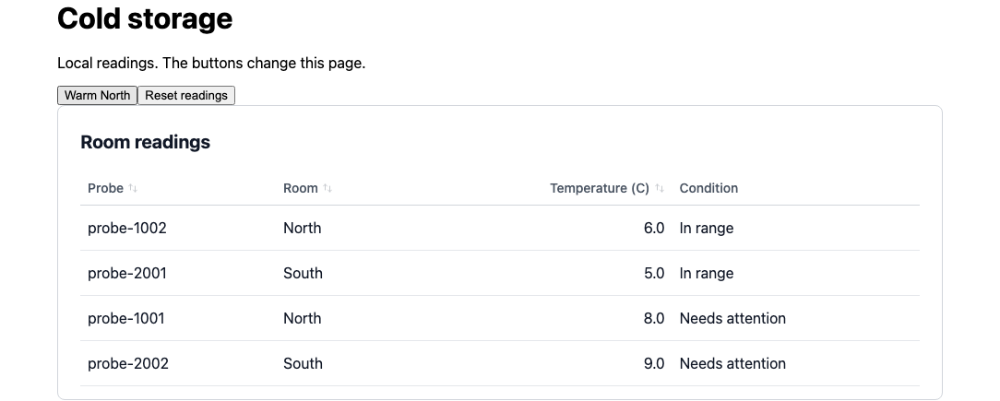

*Figure 2. A local state update changes the reading and its condition.*

**Summary.** React state owns the rows. `DataTable` supplies presentation,
sorting, and row animation. Stable `rowKey` values preserve identity when a row
changes or moves; immutable updates make that change visible to React.

<a id="3-control-sorting-and-presentation"></a>
### 2. Control sorting and presentation

**Goal:** own sorting and add controls inside the table header.
**Prerequisites:** Chapter 1's files and running Vite app.

Create **`src/sorted-cold-storage.tsx`**:

```tsx
// @drasi-docs: sorted-cold-storage.tsx
import { useState } from 'react';
import { DataTable } from '@drasi/react/components';
import { useTableSort } from '@drasi/react/react';
import { columns, initialRows, rowKey, warmNorth } from './readings';
import '@drasi/react/styles.css';

export function SortedColdStorage() {
  const [rows, setRows] = useState(initialRows);
  const sorting = useTableSort({ defaultSort: { column: 'celsius', direction: 'desc' } });
  return <main>
    <h1>Cold storage</h1>
    <DataTable title="Room readings" rows={rows} columns={columns} rowKey={rowKey}
      sort={sorting.sort} onSortChange={sorting.setSort} animateOnChange="celsius"
      headerControls={<>
        <button type="button" onClick={() => setRows(warmNorth)}>Warm North</button>
        <button type="button" onClick={() => setRows(initialRows)}>Reset readings</button>
        <button type="button" onClick={() => sorting.setSort(null)}>Input order</button>
      </>}
      headerSlot={<p>Warmest first. Warm a probe to see it move while sorted.</p>}
      renderEmpty={() => <span>No probes in this view.</span>} height="20rem" />
  </main>;
}
```

Replace **`src/main.tsx`** with this complete checkpoint:

```tsx
// @drasi-docs: sorted-main.tsx
import { StrictMode } from 'react';
import { createRoot } from 'react-dom/client';
import { SortedColdStorage } from './sorted-cold-storage';

const root = document.getElementById('root');
if (!root) throw new Error('Missing application root');
createRoot(root).render(<StrictMode><SortedColdStorage /></StrictMode>);
```

**Change and observe.** Descending starts **9, 6, 5, 3**. Warm North: its 8 C
row moves to second place and flashes. Reset, focus **Temperature (C)**, and
press Enter: ascending becomes **3, 5, 6, 9**. Space reverses it.
**Input order** restores **6, 5, 3, 9**, a visibly different third ordering.

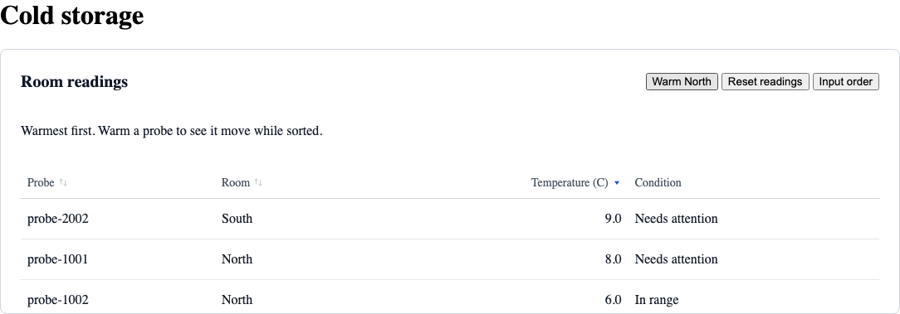

*Figure 3. Sorting follows the numeric value while formatting remains a display choice.*

`sort={null}` explicitly chooses input order. `sort={undefined}` lets the table
own sorting. In controlled mode, `onSortChange` requests a change and your owner
applies it; `defaultSort` is read only on mount. The table sorts a copy, leaving
your source array intact.

The formatter's first argument is `unknown`; use its typed row argument.
The computed `condition` text has no sortable field, so it sets `sortable: false`.
Try `toFixed(2)` in the temperature formatter: display precision changes, while
numeric sorting stays correct.

A **slot** replaces presentation while leaving data and state ownership with
the component. For example, `headerControls` adds your buttons to the built-in
header; `renderEmpty` supplies content inside its spanning cell. Return text or
elements there, rather than another `tr` or `td`. A custom row renderer should
preserve table semantics and accessible actions.

**Summary.** Use a controlled sort when another control or presentation needs
to share it. Use slots to customize one part without rebuilding the table.

<a id="7-add-actions-and-a-review-dialog"></a>
### 3. Add actions and a review dialog

**Goal:** review a current reading in a keyboard-usable dialog.
**Prerequisites:** Chapter 1; this chapter still needs no backend.

Create **`src/review-readings.tsx`**:

```tsx
// @drasi-docs: review-readings.tsx
import { useRef, useState } from 'react';
import { DataTable, Modal, type DataTableState, type RowAction } from '@drasi/react/components';
import { useTableSort } from '@drasi/react/react';
import { columns, initialRows, rowKey, type Reading } from './readings';
import '@drasi/react/styles.css';

export function ReviewReadings({ rows, state = {}, title }: {
  rows: readonly Reading[] | null; state?: DataTableState; title: string;
}) {
  const [selectedKey, setSelectedKey] = useState<string | null>(null);
  const [review, setReview] = useState('');
  const heading = useRef<HTMLHeadingElement>(null);
  const closeButton = useRef<HTMLButtonElement>(null);
  const sorting = useTableSort({ defaultSort: { column: 'celsius', direction: 'desc' } });
  const selected = rows?.find(row => row.key === selectedKey);
  const close = () => setSelectedKey(null);
  const actions: readonly RowAction<Reading>[] = [{
    icon: <span aria-hidden="true">...</span>, label: 'Review probe',
    onClick: row => setSelectedKey(row.key),
  }];
  return <section aria-label={title}>
    <h2 ref={heading} tabIndex={-1}>{title}</h2>
    <p role="status">{review}</p>
    <DataTable ariaLabel={title} rows={rows} columns={columns} rowKey={rowKey}
      state={state} actions={actions} actionsWidth="6rem"
      sort={sorting.sort} onSortChange={sorting.setSort} animateOnChange="celsius"
      height="var(--drasi-panel-height, 20rem)"
      headerControls={<button type="button" onClick={() => sorting.setSort(null)}>Input order</button>} />
    <Modal open={selectedKey !== null} onClose={close} title={`${title} - probe review`}
      initialFocusRef={closeButton} fallbackFocusRef={heading}>
      <h2>Probe review</h2>
      {selected ? <dl>
        <dt>Probe</dt><dd>{selected.key.slice(6)}</dd>
        <dt>Room</dt><dd>{selected.room}</dd>
        <dt>Temperature</dt><dd>{selected.celsius.toFixed(1)} C</dd>
      </dl> : <p>This probe is no longer in the current view.</p>}
      {state.stale && <p role="status">This reading is last-known data. Review is disabled until recovery.</p>}
      <button type="button" disabled={!selected || state.stale === true || state.error != null}
        onClick={() => {
          if (!selected) return;
          setReview(`Reviewed ${selected.room} at ${selected.celsius.toFixed(1)} C (local only).`);
          close();
        }}>Record local review</button>
      <button ref={closeButton} type="button" onClick={close}>Close review</button>
    </Modal>
  </section>;
}

export function ReviewLesson() {
  const [rows, setRows] = useState(initialRows);
  return <main>
    <h1>Cold storage</h1>
    <button type="button" onClick={() => setRows(current =>
      current.filter(row => row.key !== 'probe:probe-1001'))}>Remove probe-1001 locally</button>
    <ReviewReadings title="Local probe reviews" rows={rows} />
  </main>;
}
```

Replace **`src/main.tsx`**:

```tsx
// @drasi-docs: review-main.tsx
import { StrictMode } from 'react';
import { createRoot } from 'react-dom/client';
import { ReviewLesson } from './review-readings';

const root = document.getElementById('root');
if (!root) throw new Error('Missing application root');
createRoot(root).render(<StrictMode><ReviewLesson /></StrictMode>);
```

**Change and observe.** Tab to a **Review probe** action and press Enter.
Focus moves to **Close review**; Tab and Shift+Tab stay in the dialog.
Escape closes it and returns focus to the opener. Reopen it and record a local
review: the status message confirms the reading you reviewed.

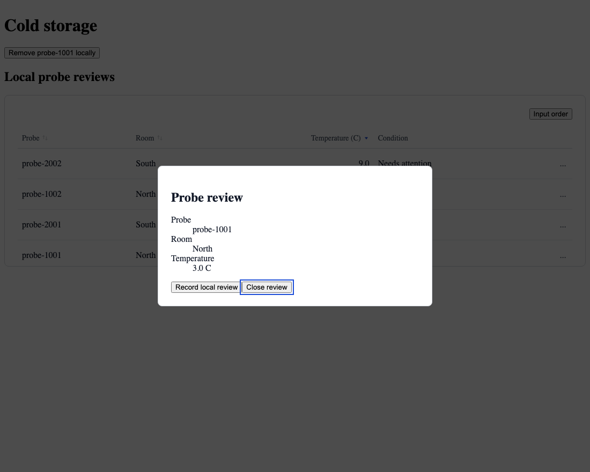

*Figure 4. The dialog reads from the same rows as the table.*

Store the **selected key**, then find its current row each render. This keeps
the dialog up to date without copying a stale row or opening another query.
In the live capstone you will delete the selected row with curl; the dialog
then shows its fallback message and Escape returns focus to the heading.

`Modal` is controlled: `onClose` requests closure, and your owner updates `open`.
It handles the portal, focus containment, Escape, background shielding, and
scroll ownership. Supply a meaningful title and a visible close control.
Keyboard activation focuses the opener consistently; for an explicit
persistent return destination, use `returnFocusRef`.

The review here is local UI state. A real save needs its own pending state,
visible failure handling, and server authorization. The query retry button
refreshes data; it does not retry your application's write.

**Summary.** Actions express intent. The app owns selection and saves, while
the modal owns dialog mechanics.

<a id="10-theme-an-accessible-responsive-screen"></a>
### 4. Theme an accessible screen

**Goal:** apply a local theme that also reaches portaled dialogs.
**Prerequisites:** Chapter 3.

Create **`src/cold-storage.css`**:

<!-- @drasi-guide-file: cold-storage.css -->
```css
.cold-storage {
  max-inline-size: 70rem;
  margin-inline: auto;
  padding: 1rem;
  font-family: system-ui, sans-serif;
  --drasi-panel-height: clamp(16rem, 45vh, 26rem);
  --drasi-line-height: 1.5;
  color: var(--drasi-color-text, #111827);
  background: var(--drasi-color-surface, #fff);
}
.cold-storage[data-theme="dark"] {
  --drasi-color-surface: #0f172a;
  --drasi-color-dialog: #0f172a;
  --drasi-color-text: #f8fafc;
  --drasi-color-muted: #cbd5e1;
  --drasi-color-subtle: #cbd5e1;
  --drasi-color-border: #64748b;
  --drasi-color-row-border: #475569;
  --drasi-color-row-hover: #1e293b;
  --drasi-color-action-hover: #334155;
  --drasi-color-primary: #93c5fd;
  --drasi-color-focus: #93c5fd;
  --drasi-color-success: #6ee7b7;
  --drasi-color-danger: #fca5a5;
}
.display-preferences { display: flex; flex-wrap: wrap; gap: 0.75rem; }
.room-grid {
  display: grid;
  grid-template-columns: repeat(auto-fit, minmax(min(100%, 24rem), 1fr));
  gap: 1rem;
}
@media print {
  .cold-storage { max-inline-size: none; color: #111; background: white; }
  .display-preferences { display: none; }
  table, figure { break-inside: avoid; }
}
```

Create **`src/theme-scope.tsx`**:

```tsx
// @drasi-docs: theme-scope.tsx
import { useState, type ReactNode } from 'react';
import { useReducedMotion } from '@drasi/react/react';
import './cold-storage.css';

export function ThemeScope({ children }: { children: ReactNode }) {
  const [dark, setDark] = useState(false);
  const [rtl, setRtl] = useState(false);
  const reducedMotion = useReducedMotion();
  return <div className="cold-storage" data-theme={dark ? 'dark' : 'light'} dir={rtl ? 'rtl' : 'ltr'}>
    <section className="display-preferences" aria-label="Display preferences">
      <button type="button" aria-pressed={dark} onClick={() => setDark(value => !value)}>Dark theme</button>
      <button type="button" aria-pressed={rtl} onClick={() => setRtl(value => !value)}>Right-to-left layout</button>
      <p>Motion preference: {reducedMotion ? 'reduced' : 'no reduction requested'}.</p>
    </section>
    {children}
  </div>;
}
```

Replace **`src/main.tsx`**:

```tsx
// @drasi-docs: theme-main.tsx
import { StrictMode } from 'react';
import { createRoot } from 'react-dom/client';
import { ReviewLesson } from './review-readings';
import { ThemeScope } from './theme-scope';

const root = document.getElementById('root');
if (!root) throw new Error('Missing application root');
createRoot(root).render(<StrictMode><ThemeScope><ReviewLesson /></ThemeScope></StrictMode>);
```

**Change and observe.** Switch to dark theme, open a review, and narrow the
window. The dialog inherits the scope even though its DOM is portaled to
`body`. Try the direction switch and your operating system's reduced-motion
preference. Values, notices, keyboard actions, and focus remain usable.

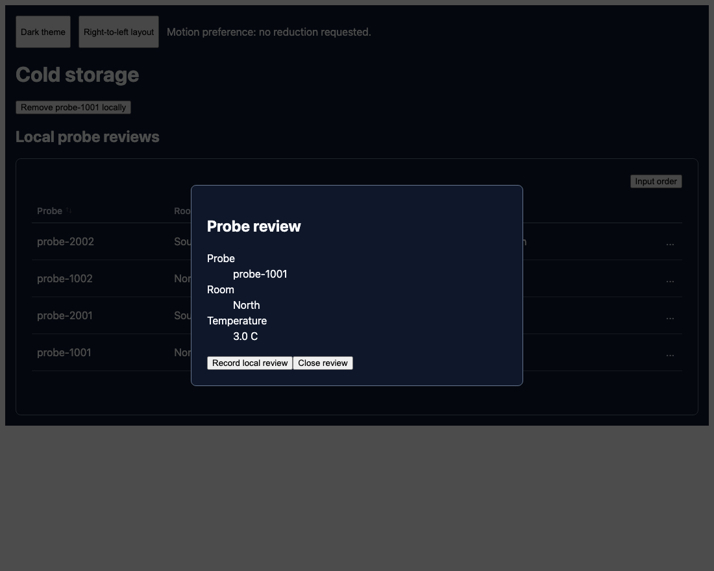

*Figure 5. Theme tokens follow the dialog's source, rather than its DOM parent.*

Give tables a title or `ariaLabel`, actions descriptive labels, and dialogs a
title plus visible controls. Preserve native buttons, table semantics,
`aria-sort`, and focus outlines when customizing. Use useful status summaries
instead of announcing every changing cell.

The modal copies resolved `--drasi-*` tokens, typography, and direction from its
source (or `themeRef`). Attribute changes and resize refresh them. For advanced
CSSOM changes, reopen or change a source attribute to refresh. RTL controls
direction; language and number formatting remain application choices.

**Summary.** Scoped CSS works for tables and portals. Exercise keyboard use,
zoom, narrow layouts, and your chosen assistive technology as part of your app's
accessibility work.

<a id="part-ii---work-with-changing-results"></a>
## Part II - Work with real Drasi results

### 5. Run the Cold storage backend

**Goal:** start a real query engine and initialize four probes.
**Prerequisites:** the installed app from Part I; internet access to GitHub and
GHCR; **macOS Apple Silicon** or **Linux x64 with glibc**. Windows readers can
run this backend in a Linux x64 WSL2 environment and use its localhost ports.
Other release platforms exist but are outside this launcher's tested matrix.

Choose the integration that fits your application:

| Starting point | Use |
| --- | --- |
| Rows already in React state | `DataTable`; Part I |
| Existing Drasi Server queries | `DrasiProvider` and `QueryTable`; this part |
| Several presentations of one query | One `useDrasiQuery`, passing its rows down |
| An existing application data service | The structural client in Appendix D |

From `cold-storage`, stop Vite if you need that terminal, then run:

```sh
node node_modules/@drasi/react/docs/developer-guide/runtime/scripts/backend.mjs
```

This command downloads **Drasi Server 0.2.4**, verifies its release checksum,
installs the pinned signed **HTTP source 0.2.13**, **scriptfile bootstrap
0.2.15**, and **SSE reaction 0.3.8**, then checks their loaded versions and
hashes. The launcher owns its files under `.cold-storage-backend` and refuses
occupied ports rather than attaching to an unrelated service. Server 0.2.4
and these plugins were exercised together against the client read/wire
contracts in this book.[^server]

It prints **Cold storage ready**, with **North: 2**, **South: 2**, and
**warm-probes: 1**. Keep it running. In another terminal:

```sh
curl --fail-with-body http://127.0.0.1:8080/health &&
curl --fail-with-body http://127.0.0.1:8082/health &&
curl --fail-with-body http://127.0.0.1:8080/api/v1/instances/cold-chain/queries/warm-probes/results
```

Expect healthy responses and one result with `probeId: "probe-2002"` and
`temperatureC: 9`. The URLs are:

| Port | Purpose |
| --- | --- |
| **8080** | Server's instance-scoped read API and `/health` |
| **8081** | SSE reaction, `/events`, with a one-second heartbeat |
| **8082** | HTTP source, `/sources/probe-feed/events` and `/health` |
| **5173** | Vite (or the port Vite prints); proxies reads and the stream |

<a id="agree-on-the-backend-contract"></a>
#### The complete backend inputs

The launcher supplies these files. They are shown here so you can see exactly
what is running and adapt the queries to your own domain.

**`server.yaml`**

```yaml
apiVersion: drasi.io/v1
host: "127.0.0.1"
port: 8080
persistConfig: false
enableUi: false
verifyPlugins: true
autoInstallPlugins: false
logLevel: info
instances:
  - id: cold-chain
    sources:
      - kind: http
        id: probe-feed
        autoStart: true
        host: "127.0.0.1"
        port: 8082
        timeoutMs: 10000
        bootstrapProvider:
          kind: scriptfile
          filePaths: ["./readings.jsonl"]
    queries:
      - id: north-room
        query: >
          MATCH (p:Probe) WHERE p.room = 'North'
          RETURN p.probeId AS probeId, p.room AS room, p.temperatureC AS temperatureC
        queryLanguage: Cypher
        autoStart: true
        sources:
          - sourceId: probe-feed
      - id: south-room
        query: >
          MATCH (p:Probe) WHERE p.room = 'South'
          RETURN p.probeId AS probeId, p.room AS room, p.temperatureC AS temperatureC
        queryLanguage: Cypher
        autoStart: true
        sources:
          - sourceId: probe-feed
      - id: warm-probes
        query: >
          MATCH (p:Probe) WHERE p.temperatureC >= 8
          RETURN p.probeId AS probeId, p.room AS room, p.temperatureC AS temperatureC
        queryLanguage: Cypher
        autoStart: true
        sources:
          - sourceId: probe-feed
    reactions:
      - kind: sse
        id: cold-chain-events
        autoStart: true
        queries: [north-room, south-room, warm-probes]
        host: "127.0.0.1"
        port: 8081
        ssePath: /events
        heartbeatIntervalMs: 1000
```

**`readings.jsonl`**

```jsonl
{"kind":"Header","start_time":"2026-01-15T12:00:00Z","description":"Deterministic cold-storage bootstrap owned by the example"}
{"kind":"Node","id":"north-spare","labels":["Probe"],"properties":{"probeId":"probe-1002","room":"North","temperatureC":6}}
{"kind":"Node","id":"south-probe","labels":["Probe"],"properties":{"probeId":"probe-2001","room":"South","temperatureC":5}}
{"kind":"Node","id":"north-probe","labels":["Probe"],"properties":{"probeId":"probe-1001","room":"North","temperatureC":3}}
{"kind":"Node","id":"south-spare","labels":["Probe"],"properties":{"probeId":"probe-2002","room":"South","temperatureC":9}}
```

Each `MATCH` selects `Probe` nodes. `WHERE` controls membership. `RETURN`
defines the fields the application will receive, including a stable `probeId`.
The source's `id` (`north-probe`) identifies an input node; the projected
`probeId` identifies the result row. Those values serve different boundaries.

**Restart and cleanup.** Ctrl+C stops only this launcher-owned server. Starting
the same command again initializes a fresh four-probe dataset; downloaded
binaries/plugins are reused only after their hashes pass. Each run keeps its
own `server.log`. After stopping, you may remove this app's `.cold-storage-backend`
directory to reclaim downloads and logs. Avoid deleting another app's directory
or stopping a service by process name. Add this directory and `node_modules/`
to your application's `.gitignore`.

**Summary.** You now own a local backend, its three listeners, and reproducible
initial data. Return to the Vite terminal and run `npm run dev`.

<a id="4-connect-to-an-existing-query"></a>
### 6. Connect your first live table

**Goal:** replace the local array with a maintained North-room answer.
**Prerequisites:** Chapter 5's ready backend and Part I's Vite configuration.

Create **`src/reading-model.ts`**. HTTP fields arrive as `unknown`, so validate
them before treating them as application readings:

```ts
// @drasi-docs: reading-model.ts
import type { RowKey } from '@drasi/ui-core';
import type { UseDrasiQueryOptions } from '@drasi/react/react';
import type { Reading } from './readings';
export { columns, rowKey, type Reading } from './readings';

export type ReadingIssue =
  | 'probeId: expected a nonempty string'
  | 'room: expected North or South'
  | 'temperatureC: expected a finite number';

export function createReadingOptions(report?: (issue: ReadingIssue) => void): UseDrasiQueryOptions<Reading> {
  const invalid = (issue: ReadingIssue): never => {
    report?.(issue);
    throw new Error(issue);
  };
  const getKey: RowKey = raw => {
    if (typeof raw.probeId !== 'string' || !raw.probeId.trim()) {
      return invalid('probeId: expected a nonempty string');
    }
    return raw.probeId;
  };
  return {
    getKey,
    transform: raw => {
      const key = getKey(raw);
      if (raw.room !== 'North' && raw.room !== 'South') return invalid('room: expected North or South');
      if (typeof raw.temperatureC !== 'number' || !Number.isFinite(raw.temperatureC)) {
        return invalid('temperatureC: expected a finite number');
      }
      return { key: `probe:${key}`, room: raw.room, celsius: raw.temperatureC };
    },
  };
}
export const readingOptions = createReadingOptions();
export const probeKey = readingOptions.getKey;
```

<a id="bind-the-connection-and-render-the-query"></a>
Create **`src/live-cold-storage.tsx`**:

```tsx
// @drasi-docs: live-cold-storage.tsx
import type { ReactNode } from 'react';
import { DrasiProvider } from '@drasi/react/adapters/drasi-server';
import { QueryTable } from '@drasi/react/components';
import { columns, readingOptions, rowKey } from './reading-model';
import '@drasi/react/styles.css';

const queryIds = ['north-room', 'south-room', 'warm-probes'];
export interface Endpoints { serverUrl: string; endpoint: string }

export function ColdStorageConnection({ serverUrl, endpoint, children }: Endpoints & { children: ReactNode }) {
  return <DrasiProvider serverUrl={serverUrl} instanceId="cold-chain" queryIds={queryIds}
    reaction={{ id: 'cold-chain-events', endpoint }}>{children}</DrasiProvider>;
}

export function LiveColdStorage() {
  return <main>
    <h1>Cold storage</h1>
    <QueryTable title="North room" queryId="north-room" queryOptions={readingOptions}
      columns={columns} rowKey={rowKey} animateOnChange="celsius" height="20rem" />
  </main>;
}
```

Replace **`src/main.tsx`**:

```tsx
// @drasi-docs: live-main.tsx
import { StrictMode } from 'react';
import { createRoot } from 'react-dom/client';
import { ColdStorageConnection, LiveColdStorage } from './live-cold-storage';

const root = document.getElementById('root');
if (!root) throw new Error('Missing application root');
const origin = window.location.origin;
createRoot(root).render(<StrictMode>
  <ColdStorageConnection serverUrl={origin} endpoint={new URL('/events', origin).href}>
    <LiveColdStorage />
  </ColdStorageConnection>
</StrictMode>);
```

**Change and observe.** North loads at **3 C** and **6 C**. In a second terminal:

```sh
curl --fail-with-body -H 'Content-Type: application/json' \
  -d '{"operation":"update","element":{"type":"node","id":"north-probe","labels":["Probe"],"properties":{"probeId":"probe-1001","room":"North","temperatureC":8}}}' \
  http://127.0.0.1:8082/sources/probe-feed/events
```

`probe-1001` changes to **8.0 C** without reloading the page. This is the real
HTTP source's payload. Omitting its optional timestamp lets the source assign
the current time.[^feed]

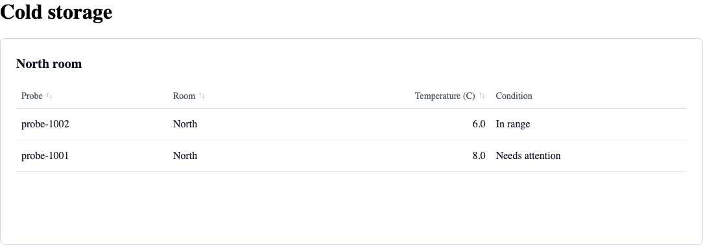

*Figure 6. The browser presents a real changed query result.*

Every hook or `QueryTable` query ID must appear in **both**
`DrasiProvider.queryIds` and the SSE reaction's `queries`.
A subscription outside the provider's set raises `INVALID_CONFIGURATION`;
a configured query missing from reaction membership fails validation with
`INCOMPATIBLE_RESOURCE`. The provider validates all its configured references,
so a bad reference can prevent the shared connection from opening.

The provider owns one connection; `QueryTable` combines a query hook and a table.
It reads existing resources. Configuration, source writes, and query definitions
belong to the backend setup you just ran.

**Summary.** A provider connects your components to an existing backend.
`QueryTable` is the shortest route from a query ID to a live table.

<a id="2-model-rows-and-preserve-identity"></a>
### 7. Preserve identity through deletes

**Goal:** see why raw identity and render identity are separate.
**Prerequisites:** Chapter 6; keep its entrypoint.

Create a third North probe:

```sh
curl --fail-with-body -H 'Content-Type: application/json' \
  -d '{"operation":"insert","element":{"type":"node","id":"new-probe","labels":["Probe"],"properties":{"probeId":"probe-3001","room":"North","temperatureC":2}}}' \
  http://127.0.0.1:8082/sources/probe-feed/events
```

**Change and observe.** North gains a **2.0 C** row. Delete that source node:

```sh
curl --fail-with-body -H 'Content-Type: application/json' \
  -d '{"operation":"delete","id":"new-probe","labels":["Probe"]}' \
  http://127.0.0.1:8082/sources/probe-feed/events
```

The row disappears. Rerun the insert to restore it, then delete it again to
leave the original dataset ready for the next chapter.

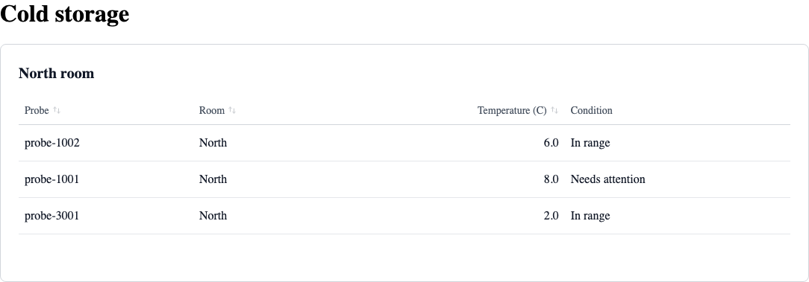

*Figure 7. Inserting and deleting one source identity adds and removes one result row.*

| Identity | Input | Purpose |
| --- | --- | --- |
| `getKey`, here `probeKey` | Raw result rows, including sparse deletes | Update the retained result set |
| `rowKey` | Projected `Reading` objects | Preserve React rows, focus, and animation identity |

A gateway can send a delete containing only `{ "probeId": "probe-3001" }`.
`getKey` must still work. Deletion removes the retained row **before**
projection; `transform` does not need to format the deleted row.
The released source's input delete uses `id`; its query-result delete carries
the projected identity. Chapter 14 tests an identity-only result delete too.

Use a stable domain key, rather than an array index, the current temperature,
a timestamp, or a backend `row_signature`. A key-changing update removes its
old identity before adding the new one.

**Summary.** Keep the key readable even on sparse deletes. Validate display
fields only when projecting rows that remain in the answer.

### 8. Watch rows enter and leave an answer

**Goal:** distinguish a row update from a change in query membership.
**Prerequisites:** Chapters 5-7 and the original four probes.

Create **`src/warm-queries.tsx`**, adding a third visible query:

```tsx
// @drasi-docs: warm-queries.tsx
import { QueryTable } from '@drasi/react/components';
import { columns, readingOptions, rowKey } from './reading-model';

export function WarmQueries() {
  return <main>
    <h1>Cold storage</h1>
    {[
      ['north-room', 'North room'], ['south-room', 'South room'], ['warm-probes', 'Warm probes'],
    ].map(([queryId, title]) => <QueryTable key={queryId} title={title}
      queryId={queryId} queryOptions={readingOptions} columns={columns} rowKey={rowKey}
      animateOnChange="celsius" height="14rem" />)}
  </main>;
}
```

Replace **`src/main.tsx`**:

```tsx
// @drasi-docs: warm-main.tsx
import { StrictMode } from 'react';
import { createRoot } from 'react-dom/client';
import { ColdStorageConnection } from './live-cold-storage';
import { WarmQueries } from './warm-queries';

const root = document.getElementById('root');
if (!root) throw new Error('Missing application root');
const origin = window.location.origin;
createRoot(root).render(<StrictMode>
  <ColdStorageConnection serverUrl={origin} endpoint={new URL('/events', origin).href}>
    <WarmQueries />
  </ColdStorageConnection>
</StrictMode>);
```

The query is already in `server.yaml`:

```cypher
MATCH (p:Probe) WHERE p.temperatureC >= 8
RETURN p.probeId AS probeId, p.room AS room, p.temperatureC AS temperatureC
```

**Change and observe.** Run these one at a time, watching all three tables:

```sh
curl --fail-with-body -H 'Content-Type: application/json' -d '{"operation":"update","element":{"type":"node","id":"north-probe","labels":["Probe"],"properties":{"probeId":"probe-1001","room":"North","temperatureC":4}}}' http://127.0.0.1:8082/sources/probe-feed/events
curl --fail-with-body -H 'Content-Type: application/json' -d '{"operation":"update","element":{"type":"node","id":"north-probe","labels":["Probe"],"properties":{"probeId":"probe-1001","room":"North","temperatureC":8}}}' http://127.0.0.1:8082/sources/probe-feed/events
curl --fail-with-body -H 'Content-Type: application/json' -d '{"operation":"update","element":{"type":"node","id":"north-probe","labels":["Probe"],"properties":{"probeId":"probe-1001","room":"North","temperatureC":9}}}' http://127.0.0.1:8082/sources/probe-feed/events
curl --fail-with-body -H 'Content-Type: application/json' -d '{"operation":"update","element":{"type":"node","id":"north-probe","labels":["Probe"],"properties":{"probeId":"probe-1001","room":"North","temperatureC":4}}}' http://127.0.0.1:8082/sources/probe-feed/events
```

At 4 C, North retains the probe and Warm omits it. At 8 C it **enters** Warm.
At 9 C it **updates while remaining present**. Back at 4 C it **leaves** Warm,
while its North row remains. South's 9 C probe remains in Warm throughout.

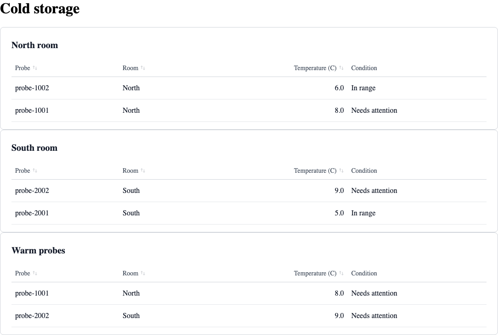

*Figure 8. One input change can update one answer and change another answer's membership.*

**Check the configuration rule.** Temporarily remove only `'warm-probes'` from
the `queryIds` array in `live-cold-storage.tsx`, save, and inspect the rejected
Warm subscription in the development console. The low-level subscription
throws `DrasiError` with code `INVALID_CONFIGURATION` synchronously; an
application error boundary or the development overlay handles that programming
error. Restore the ID to recover. To exercise reaction
membership independently, stop the launcher, use a copy of its printed run's
`server.yaml` with Warm removed from the reaction's `queries`, and start the
verified downloaded binary with that config and the same printed plugins
directory. The provider then reports `INCOMPATIBLE_RESOURCE`. Restore the
original config or restart the launcher before continuing. Provider membership
and reaction membership are separate checks.

**Summary.** Push a selection into a continuous query when membership itself
matters. A browser-only filter changes presentation; this query changes its
maintained backend answer.

<a id="5-share-one-query-across-presentations"></a>
### 9. Share one query across presentations

**Goal:** feed a count, cards, and table from one accepted view.
**Prerequisites:** Chapter 6.

Create **`src/cold-storage-dashboard.tsx`**:

```tsx
// @drasi-docs: cold-storage-dashboard.tsx
import { useMemo, useState } from 'react';
import { DataTable, queryTableState } from '@drasi/react/components';
import { useDrasiClient, useDrasiConnectionStatus, useDrasiQuery, useTableSort,
  type UseDrasiQueryOptions } from '@drasi/react/react';
import type { DrasiError } from '@drasi/ui-core';
import { columns, readingOptions, rowKey, type Reading } from './reading-model';

export function RoomDashboard({ queryId, title, options = readingOptions }: {
  queryId: string; title: string; options?: UseDrasiQueryOptions<Reading>;
}) {
  const [warmOnly, setWarmOnly] = useState(false);
  const filtered = useMemo<UseDrasiQueryOptions<Reading>>(() => ({
    ...options, transform: raw => {
      const row = options.transform(raw);
      return row && (!warmOnly || row.celsius >= 8) ? row : null;
    },
  }), [options, warmOnly]);
  const query = useDrasiQuery(queryId, filtered);
  const { retry: retryConnection } = useDrasiClient();
  const connection = useDrasiConnectionStatus();
  const sorting = useTableSort({ defaultSort: { column: 'celsius', direction: 'desc' } });
  return <section aria-label={title}>
    <h2>{title}</h2>
    <label><input type="checkbox" checked={warmOnly}
      onChange={event => setWarmOnly(event.target.checked)} /> Show warm probes only</label>
    <p role="status">Query: {query.status}{query.stale ? ' (last-known data)' : ''}.
      {' '}Visible probes: {query.data === null ? 'not known yet' : query.data.length}.</p>
    {query.data !== null && <ul aria-label={`${title} cards`}>{query.data.map(row =>
      <li key={row.key}>{row.key.slice(6)} - {row.room}: {row.celsius.toFixed(1)} C
        {row.celsius >= 8 ? ' - Needs attention' : ' - In range'}</li>)}</ul>}
    <DataTable<Reading, DrasiError> title={`${title} readings`} rows={query.data}
      columns={columns} rowKey={rowKey} state={queryTableState(query, retryConnection)}
      sort={sorting.sort} onSortChange={sorting.setSort} animateOnChange="celsius" height="20rem"
      headerControls={<>
        <button type="button" onClick={() => sorting.setSort(null)}>Input order</button>
        <button type="button" onClick={query.retry} disabled={!connection.connected}>Refresh query</button>
      </>}
      renderEmpty={() => <span>No probes match this view.</span>}
      renderError={({ error, state }) => <div role="alert">
        <p>{error.code}: {error.message}</p>
        {state.stale && <p>Showing last known readings.</p>}
        {error.code === 'RESULT_PROCESSING_FAILED' || error.code === 'INVALID_ROW_KEY'
          ? <p>Correct the projection or identity callback before refreshing.</p>
          : state.retry && <button type="button" onClick={state.retry}>{state.retryLabel}</button>}
      </div>} />
  </section>;
}
export function ColdStorageDashboard() {
  return <main><h1>Cold storage</h1>
    <RoomDashboard queryId="north-room" title="North room" />
    <RoomDashboard queryId="south-room" title="South room" />
  </main>;
}
```

Replace **`src/main.tsx`**:

```tsx
// @drasi-docs: dashboard-main.tsx
import { StrictMode } from 'react';
import { createRoot } from 'react-dom/client';
import { ColdStorageConnection } from './live-cold-storage';
import { ColdStorageDashboard } from './cold-storage-dashboard';

const root = document.getElementById('root');
if (!root) throw new Error('Missing application root');
const origin = window.location.origin;
createRoot(root).render(<StrictMode>
  <ColdStorageConnection serverUrl={origin} endpoint={new URL('/events', origin).href}>
    <ColdStorageDashboard />
  </ColdStorageConnection>
</StrictMode>);
```

**Change and observe.** Select North's warm filter, then send Chapter 8's 4 C
and 8 C updates. The count, cards, and table agree. Clearing the filter
reprojects retained rows; it neither opens a new stream nor reads a new snapshot.
Check the browser Network panel while toggling it.

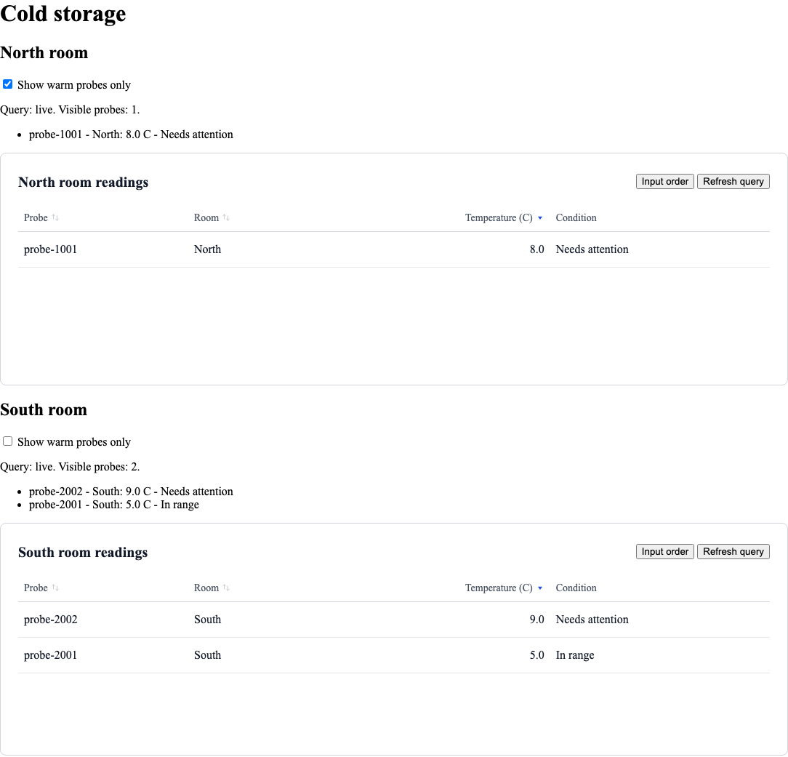

*Figure 9. Presentations share one hook rather than duplicate subscriptions.*

A provider shares a **connection**, not a query cache. Two hooks for the same
ID create independent subscriptions and snapshot reads. Hoist one hook when
presentations should share its accepted view.

Define constant query callbacks at module scope, or use `useMemo` /
`useCallback` when they depend on props or state. This avoids unnecessary
projection work. It is a recommendation, not an object-identity requirement:
`useDrasiQuery` tracks `getKey`, `transform`, and `postProcess`, not the outer
options object's identity. Changing those callbacks intentionally reprojects
retained rows without reopening the transport.

To share flashes across two tables, hoist `useRowAnimation` too. Its
`animations` return value goes to **`rowAnimations`**; its `revisions` goes to
**`rowAnimationRevisions`**. Pass both, so another change with the same animation
name can restart it. `useTableSort` similarly shares `sort` and `setSort`.

**Summary.** One hook can power many presentations. Callback changes are useful
for local filters; stable identities keep unchanged projections inexpensive.

<a id="6-keep-failures-and-recovery-visible"></a>
### 10. Keep failures and recovery visible

**Goal:** trigger errors and recover while preserving useful readings.
**Prerequisites:** Chapter 9.

Create **`src/connection-notice.tsx`**:

```tsx
// @drasi-docs: connection-notice.tsx
import { useDrasiClient, useDrasiConnectionStatus } from '@drasi/react/react';

export function ConnectionNotice() {
  const connection = useDrasiConnectionStatus();
  const { error, retry } = useDrasiClient();
  return <section aria-label="Connection">
    <p role="status">Stream: {connection.connected ? 'open'
      : connection.reconnecting ? 'reconnecting' : 'not open'}.</p>
    {error && <div role="alert"><p>{error.code}: {error.message}</p>
      <button type="button" onClick={retry}>Retry connection</button></div>}
  </section>;
}
```

Create **`src/failure-lesson.tsx`**:

```tsx
// @drasi-docs: failure-lesson.tsx
import { useMemo, useState } from 'react';
import { createReadingOptions, type ReadingIssue } from './reading-model';
import { RoomDashboard } from './cold-storage-dashboard';
import { ConnectionNotice } from './connection-notice';

const report = (issue: ReadingIssue) => {
  if (import.meta.env.DEV) console.warn('Cold storage row validation:', issue);
};
const diagnosticOptions = createReadingOptions(report);

export function FailureLesson() {
  const [broken, setBroken] = useState(false);
  const options = useMemo(() => ({
    ...diagnosticOptions, transform: (raw: Parameters<typeof diagnosticOptions.transform>[0]) => {
      if (broken) throw new Error('Deliberate projection exercise');
      return diagnosticOptions.transform(raw);
    },
  }), [broken]);
  return <main>
    <h1>Cold storage</h1>
    <ConnectionNotice />
    <label><input type="checkbox" checked={broken}
      onChange={event => setBroken(event.target.checked)} />
      Demonstrate a projection error (client only)</label>
    <RoomDashboard queryId="north-room" title="North room" options={options} />
    <RoomDashboard queryId="south-room" title="South room" />
  </main>;
}
```

Replace **`src/main.tsx`**:

```tsx
// @drasi-docs: failure-main.tsx
import { StrictMode } from 'react';
import { createRoot } from 'react-dom/client';
import { ColdStorageConnection } from './live-cold-storage';
import { FailureLesson } from './failure-lesson';

const root = document.getElementById('root');
if (!root) throw new Error('Missing application root');
const origin = window.location.origin;
createRoot(root).render(<StrictMode>
  <ColdStorageConnection serverUrl={origin} endpoint={new URL('/events', origin).href}>
    <FailureLesson />
  </ColdStorageConnection>
</StrictMode>);
```

**Change and observe: projection failure.** Check the box. North retains its
accepted readings and shows `RESULT_PROCESSING_FAILED` / `terminal-error`.
South stays live. Uncheck it: corrected code reprojects the retained rows,
without reconnecting. A retry while the callback is broken cannot repair it.
Our error slot therefore offers correction advice rather than a useless retry.

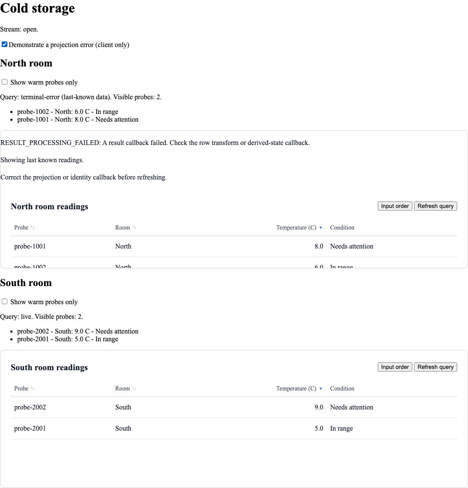

*Figure 10. Terminal describes stopped automatic recovery, not an unfixable application.*

Thrown callback messages are **sanitized** into typed codes. The original
exception text is not forwarded to the UI or automatically logged. The
development wrapper above reports only a closed set of static field/reason
strings, such as `temperatureC: expected a finite number`. It never prints
the raw row, a token, or arbitrary exception text. The remedy table in
Chapter 15 maps the actual codes to useful next actions.

**Change and observe: reconnect.** With readings visible, press Ctrl+C in the
backend terminal. The notice changes to **reconnecting** and rows become
last-known data. Restart the same backend command; a fresh snapshot restores
the initialized readings. **Refresh query** rereads that room only; connection
retry restarts shared work.

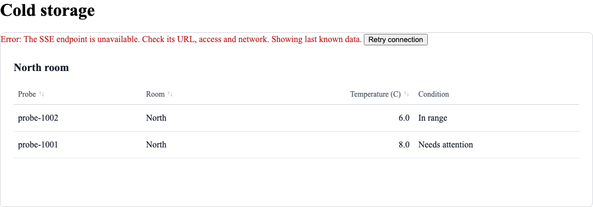

*Figure 11. The default table gives errors precedence over its stale notice.*

`QueryTable`'s default notice order is **error, stale, loading**. A routine
reconnect can therefore show a red `STREAM_UNAVAILABLE` error while retaining
rows; it does not automatically replace that with a neutral stale label.
Our composed error slot intentionally also says **Showing last known readings**.
An open connection and a ready query are separate observations.

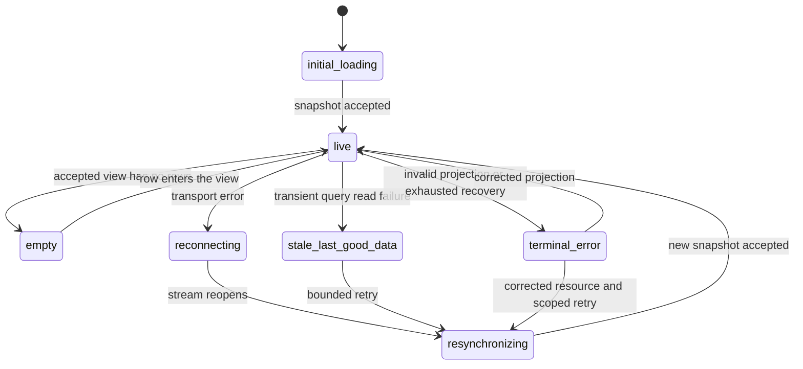

*Figure 12. Observable query states. Hyphens in API values correspond to underscores in this diagram.*

| API state | How to exercise it | Interpretation |
| --- | --- | --- |
| `initial-loading` | Reload with Network throttling before the first snapshot | No accepted baseline yet |
| `live` | Let the snapshot finish | An accepted view with rows |
| `empty` | Enable North's warm filter while both probes are below 8 C | An accepted view containing zero rows |
| `reconnecting` | Stop the backend while the stream is open | Shared transport recovery; retained rows are stale |
| `resynchronizing` | Restart the backend, or press Refresh query with throttling | Another baseline is being read |
| `stale-last-good-data` | Block only a query's `/results` request in DevTools, then refresh it | A transient query read failed; useful old rows remain |
| `terminal-error` | Use the projection checkbox, or exhaust bounded recovery | Automatic work has stopped; correct the cause |

Transient states may be brief or batched in a render. Use the Network panel
and throttling to observe them; a UI need not paint every intermediate state.

#### Stream liveness and the snapshot boundary

The native transport has an **opening timeout**, not a heartbeat watchdog.
A silent proxy can keep a stream looking open after its upstream stops. Quiet
query data alone is normal and cannot diagnose that condition.
The Vite configuration deliberately propagates upstream failures and enforces
a **five-second upstream inactivity limit**, relying on this example's
**one-second SSE heartbeat**. Any upstream bytes reset that limit. This is a
local proxy policy, not a new library retry policy. Use an equivalent,
verified heartbeat/streaming policy in production; a generic quiet stream
without that heartbeat needs a different timeout.

```mermaid
sequenceDiagram
    participant UI as Query subscriber
    participant SSE as Open SSE transport
    participant HTTP as Snapshot endpoint
    UI->>SSE: Subscribe to this query
    UI->>HTTP: GET current results
    alt a delta overlaps the pending read
        SSE-->>UI: Delta (counted, not replayed)
        HTTP-->>UI: Candidate snapshot
        Note over UI: Discard candidate; SNAPSHOT_OVERLAP
        UI->>HTTP: Bounded retry of snapshot
    else no overlap observed
        HTTP-->>UI: Snapshot
        Note over UI: Accept baseline, then report live
        SSE-->>UI: Later delta
        Note over UI: Update retained rows
    end
```

*Figure 13. Subscribe first, then read. There is no shared snapshot/stream cursor.*

<a id="know-what-live-does-not-guarantee"></a>
**Guarantees in one place.** Snapshots and deltas are best-effort browser
state, rather than a gap-free replay log. Observed overlap causes bounded
resynchronization; too many pending changes produce `RESULT_BUFFER_OVERFLOW`.
A delayed older delta arriving after a newer snapshot is still indistinguishable
from a new change. Receipt times and row signatures are not ordering cursors.
Refresh obtains another baseline. Strong ordering, replay, exactly-once effects,
and cross-query transactions need an appropriate backend protocol.

**Summary.** Preserve useful rows, label recovery honestly, and retry the
smallest scope. Correct callback failures in code; use heartbeat-aware proxies
to detect transport silence.

### 11. React to change in application code

**Goal:** show one toast when a probe becomes warm.
**Prerequisites:** Chapters 6 and 10.

Comparing `query.data` in an effect is useful for simple view comparisons, but
it cannot reliably distinguish a resync snapshot from a live transition:
React may batch the intermediate states. Use the existing public
**snapshot/delta subscription contract** before rendering instead.
This app-owned wrapper adds notifications while the normal hook still owns
its rows.

Create **`src/threshold-alerts.ts`**:

```ts
// @drasi-docs: threshold-alerts.ts
import { accumulateResult, type QueryClient, type QueryResult, type QuerySubscription,
  type QuerySubscriptionState, type ResultRow } from '@drasi/ui-core';
import { probeKey, readingOptions, type Reading } from './reading-model';

export function createWarmTracker() {
  let rows: ResultRow[] = [];
  let baseline = false;
  let live = false;
  return {
    state(state: QuerySubscriptionState) { live = state.status === 'live' && !state.stale; },
    accept(result: QueryResult): Reading[] {
      if (result.kind === 'snapshot') {
        rows = accumulateResult(rows, result, probeKey);
        baseline = true;
        return [];
      }
      let next = rows;
      const alerts: Reading[] = [];
      for (const change of result.changes) {
        const before = next;
        next = accumulateResult(next, { ...result, changes: [change] }, probeKey);
        if (baseline && live && change.kind !== 'delete') {
          const row = readingOptions.transform(change.after);
          const previous = before.find(raw => probeKey(raw) === probeKey(change.after));
          const prior = previous ? readingOptions.transform(previous) : null;
          if (row && row.celsius >= 8 && (!prior || prior.celsius < 8)) alerts.push(row);
        }
      }
      rows = next;
      return alerts;
    },
  };
}

export function withWarmAlerts(client: QueryClient, notify: (row: Reading) => void): QueryClient {
  return {
    instanceId: client.instanceId,
    getConnectionStatus: () => client.getConnectionStatus(),
    onConnectionStatusChange: callback => client.onConnectionStatusChange(callback),
    subscribe(queryId, onResult, onError, onState) {
      const tracker = createWarmTracker();
      let active = true;
      const subscription = client.subscribe(queryId, result => {
        if (!active) return;
        onResult(result);
        const alerts = tracker.accept(result);
        if (queryId === 'north-room') alerts.forEach(notify);
      }, error => {
        if (active) onError?.(error);
      }, state => {
        if (!active) return;
        tracker.state(state);
        onState?.(state);
      });
      const stop: QuerySubscription = Object.assign(() => {
        active = false;
        subscription();
      }, { retry: () => subscription.retry(), getState: () => subscription.getState() });
      return stop;
    },
  };
}
```

Create **`src/notification-lesson.tsx`**:

```tsx
// @drasi-docs: notification-lesson.tsx
import { useCallback, useEffect, useMemo, useRef, useState } from 'react';
import { DrasiClientProvider, useDrasiClient } from '@drasi/react/react';
import type { Reading } from './reading-model';
import { withWarmAlerts } from './threshold-alerts';
import { ColdStorageDashboard } from './cold-storage-dashboard';
import { ConnectionNotice } from './connection-notice';

export function NotificationLesson() {
  const context = useDrasiClient();
  const sequence = useRef(0);
  const [toasts, setToasts] = useState<{ id: number; text: string }[]>([]);
  const notify = useCallback((row: Reading) => {
    const id = ++sequence.current;
    setToasts(current => [...current, { id,
      text: `${row.key.slice(6)} is now warm: ${row.celsius.toFixed(1)} C.` }]);
  }, []);
  const client = useMemo(() => context.client ? withWarmAlerts(context.client, notify) : null,
    [context.client, notify]);
  useEffect(() => { setToasts([]); }, [client]);
  const value = useMemo(() => ({ ...context, client }), [context, client]);
  return <DrasiClientProvider value={value}>
    <ConnectionNotice />
    <ol aria-label="Warm notifications" aria-live="polite">
      {toasts.map(toast => <li key={toast.id}>{toast.text}
        <button type="button" onClick={() => setToasts(current =>
          current.filter(item => item.id !== toast.id))}>Dismiss notification</button>
      </li>)}
    </ol>
    <ColdStorageDashboard />
  </DrasiClientProvider>;
}
```

Replace **`src/main.tsx`**:

```tsx
// @drasi-docs: notification-main.tsx
import { StrictMode } from 'react';
import { createRoot } from 'react-dom/client';
import { ColdStorageConnection } from './live-cold-storage';
import { NotificationLesson } from './notification-lesson';

const root = document.getElementById('root');
if (!root) throw new Error('Missing application root');
const origin = window.location.origin;
createRoot(root).render(<StrictMode>
  <ColdStorageConnection serverUrl={origin} endpoint={new URL('/events', origin).href}>
    <NotificationLesson />
  </ColdStorageConnection>
</StrictMode>);
```

**Change and observe.** Run Chapter 8's 4 C, 8 C, 9 C, 4 C sequence.
Only the 4-to-8 transition produces a toast. Another 8 C update, a filter
toggle, a rerender, or Refresh query adds none. Warm it again after cooling:
another toast is appropriate. Reload while it is already warm: the new
snapshot establishes a quiet baseline.

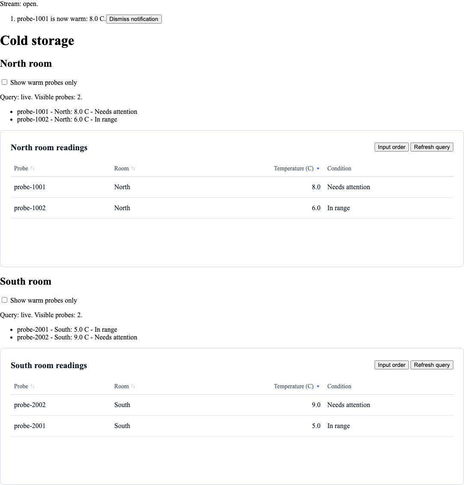

*Figure 14. An observed live transition, rather than the initial answer, creates a toast.*

The tracker keys raw rows by stable identity. A live deletion removes that
identity; reinserting it warm counts as a new entry and creates one toast.
An update that stays warm creates none. Every snapshot replaces the baseline
quietly, including resync snapshots. Stopped subscriptions ignore late
callbacks, and StrictMode's repeated setup gets a new quiet baseline.
Keep one North subscription for this recipe; duplicating the subscription
would duplicate its notification ownership.

These are **ephemeral browser notifications**. They intentionally disappear
on reload or connection-owner replacement. The delayed-event limitation from
Chapter 10 still applies: without an ordering cursor, an old delta may resemble
a new crossing. Put durable alerts, audit records, and business effects in a
backend Drasi reaction with the persistence and delivery guarantees you need.

**Summary.** React to normalized changes when event meaning matters, then use
React state to present a small, useful notification.

## Part III - Own the application

<a id="9-authenticate-and-reconfigure-safely"></a>
### 12. Authenticate both transports

**Goal:** send fresh authentication on snapshot reads and stream openings.
**Prerequisites:** Chapter 6 and its backend.

A same-origin cookie session is often the simplest production integration.
For bearer headers, native `EventSource` is insufficient: it cannot apply
arbitrary headers or `credentials: 'omit'`. The following **application-owned
fetch transport** implements the public `EventSourceFactory` contract without
adding a package dependency or a second reconnect loop.

Create **`src/fetch-event-source.ts`**:

```ts
// @drasi-docs: fetch-event-source.ts
import { DrasiError, type EventSourceFactory, type EventSourceLike } from '@drasi/ui-core';

export const openAuthenticatedStream: EventSourceFactory = (url, options) => {
  const controller = new AbortController();
  const listeners = new Map<string, Set<EventListener>>();
  let closed = false;
  const source: EventSourceLike = {
    onopen: null, onmessage: null, onerror: null,
    addEventListener(type, listener) {
      let group = listeners.get(type);
      if (!group) { group = new Set(); listeners.set(type, group); }
      group.add(listener);
    },
    close() {
      closed = true;
      controller.abort();
      options.signal.removeEventListener('abort', abort);
      listeners.clear();
    },
  };
  const abort = () => source.close();
  options.signal.addEventListener('abort', abort, { once: true });
  if (options.signal.aborted) source.close();

  async function receive() {
    if (closed) return;
    const headers = new Headers(options.headers);
    headers.set('Accept', 'text/event-stream');
    const response = await fetch(url, {
      headers, credentials: options.credentials, redirect: 'error', signal: controller.signal,
    });
    if (!response.ok || !response.body ||
        !/^text\/event-stream(?:;|$)/i.test(response.headers.get('content-type') ?? '')) {
      throw new DrasiError('STREAM_UNAVAILABLE');
    }
    if (closed) return;
    source.onopen?.(new Event('open'));
    const reader = response.body.getReader();
    const decoder = new TextDecoder();
    let pending = '', eventType = '', data: string[] = [], eventBytes = 0;
    const line = (value: string) => {
      if (value === '') {
        if (data.length) {
          const type = eventType || 'message';
          const event = new MessageEvent<string>(type, { data: data.join('\n') });
          if (type === 'message') source.onmessage?.(event);
          for (const listener of listeners.get(type) ?? []) listener(event);
        }
        eventType = ''; data = []; eventBytes = 0;
      } else if (!value.startsWith(':')) {
        eventBytes += value.length;
        if (eventBytes > 1_048_576) throw new DrasiError('INVALID_PAYLOAD');
        const colon = value.indexOf(':');
        const field = colon < 0 ? value : value.slice(0, colon);
        const body = colon < 0 ? '' : value.slice(colon + 1).replace(/^ /, '');
        if (field === 'event') eventType = body;
        if (field === 'data') data.push(body);
      }
    };
    try {
      while (!closed) {
        const chunk = await reader.read();
        if (chunk.done) {
          pending += decoder.decode();
          if (pending.endsWith('\r')) line(pending.slice(0, -1));
          break;
        }
        pending += decoder.decode(chunk.value, { stream: true });
        let end;
        while ((end = pending.search(/[\r\n]/)) >= 0) {
          if (pending[end] === '\r' && end === pending.length - 1) break;
          const width = pending.slice(end, end + 2) === '\r\n' ? 2 : 1;
          const value = pending.slice(0, end);
          pending = pending.slice(end + width);
          line(value);
          if (closed) return;
        }
        if (pending.length + eventBytes > 1_048_576) throw new DrasiError('INVALID_PAYLOAD');
      }
    } finally { reader.releaseLock(); }
    if (!closed) throw new DrasiError('STREAM_UNAVAILABLE');
  }
  void receive().catch(() => {
    if (!closed) {
      source.onerror?.(new Event('error'));
      source.close();
    }
  });
  return source;
};
```

This parser handles chunked UTF-8, multi-line data, LF/CRLF/CR lines, comments,
unnamed `message` events, and named events. Other fields, including `retry`
and `id`, do not create replay or reconnect behavior. It bounds a pending
message at one million characters. Failure reaches the client's error path;
Server revalidation classifies authentication errors through REST. `close()`
and the supplied signal cancel the request. The **Drasi client alone owns
bounded reconnection**, acquiring fresh headers for each attempt.

Create **`src/authenticated-cold-storage.tsx`**:

```tsx
// @drasi-docs: authenticated-cold-storage.tsx
import { useMemo, type ReactNode } from 'react';
import { DrasiProvider } from '@drasi/react/adapters/drasi-server';
import { DrasiError, type DrasiHeadersProvider } from '@drasi/ui-core';
import { openAuthenticatedStream } from './fetch-event-source';
import type { Endpoints } from './live-cold-storage';

export function AuthenticatedColdStorage({
  serverUrl, endpoint, getAccessToken, children,
}: Endpoints & {
  getAccessToken: (signal: AbortSignal) => Promise<string>; children: ReactNode;
}) {
  const headers = useMemo<DrasiHeadersProvider>(() => async ({ signal }) => {
    const token = await getAccessToken(signal);
    if (!token) throw new DrasiError('UNAUTHENTICATED');
    return { Authorization: `Bearer ${token}` };
  }, [getAccessToken]);
  return <DrasiProvider serverUrl={serverUrl} instanceId="cold-chain"
    queryIds={['north-room', 'south-room', 'warm-probes']}
    reaction={{ id: 'cold-chain-events', endpoint }}
    headers={headers} credentials="omit" eventSourceFactory={openAuthenticatedStream}>
    {children}
  </DrasiProvider>;
}
```

#### Run an authenticated stream

Keep the backend and Vite running. In another terminal start the packaged
**local authentication exercise gateway**:

```sh
node node_modules/@drasi/react/docs/developer-guide/runtime/scripts/auth-gateway.mjs
```

It listens on **127.0.0.1:8083**, authenticates both read and stream routes, and
forwards the real backend's bytes. Its `/lesson-session` route issues fresh
short-lived, in-memory exercise tokens. This is a runnable local authentication
example, **not a production login service**. The query engine remains the
released Drasi Server from Chapter 5.

Replace **`src/main.tsx`**:

```tsx
// @drasi-docs: authenticated-main.tsx
import { StrictMode } from 'react';
import { createRoot } from 'react-dom/client';
import { DrasiError } from '@drasi/ui-core';
import { AuthenticatedColdStorage } from './authenticated-cold-storage';
import { ColdStorageDashboard } from './cold-storage-dashboard';
import { ConnectionNotice } from './connection-notice';

async function getAccessToken(signal: AbortSignal): Promise<string> {
  const response = await fetch('/lesson-session', { signal, credentials: 'omit', cache: 'no-store' });
  if (!response.ok) throw new DrasiError('UNAUTHENTICATED');
  const body: unknown = await response.json();
  if (!body || typeof body !== 'object' || !('accessToken' in body) ||
      typeof body.accessToken !== 'string') throw new DrasiError('UNAUTHENTICATED');
  return body.accessToken;
}
const root = document.getElementById('root');
if (!root) throw new Error('Missing application root');
const origin = window.location.origin;
createRoot(root).render(<StrictMode>
  <AuthenticatedColdStorage serverUrl={new URL('/secured', origin).href}
    endpoint={new URL('/secured/events', origin).href} getAccessToken={getAccessToken}>
    <ConnectionNotice /><ColdStorageDashboard />
  </AuthenticatedColdStorage>
</StrictMode>);
```

**Change and observe.** The tables load through `/secured/...`; send the
Chapter 8 updates and watch them change. This unauthenticated request fails
with **401**, rather than exposing a snapshot:

```sh
curl --include http://127.0.0.1:8083/secured/api/v1/instances/cold-chain/queries/north-room/results
```

Refresh a query, then stop and restart the gateway with Ctrl+C and the same
command. Reconnection obtains a fresh token and opens a new authenticated
stream. Inspect status codes and request counts, rather than copying token
values into logs or screenshots.

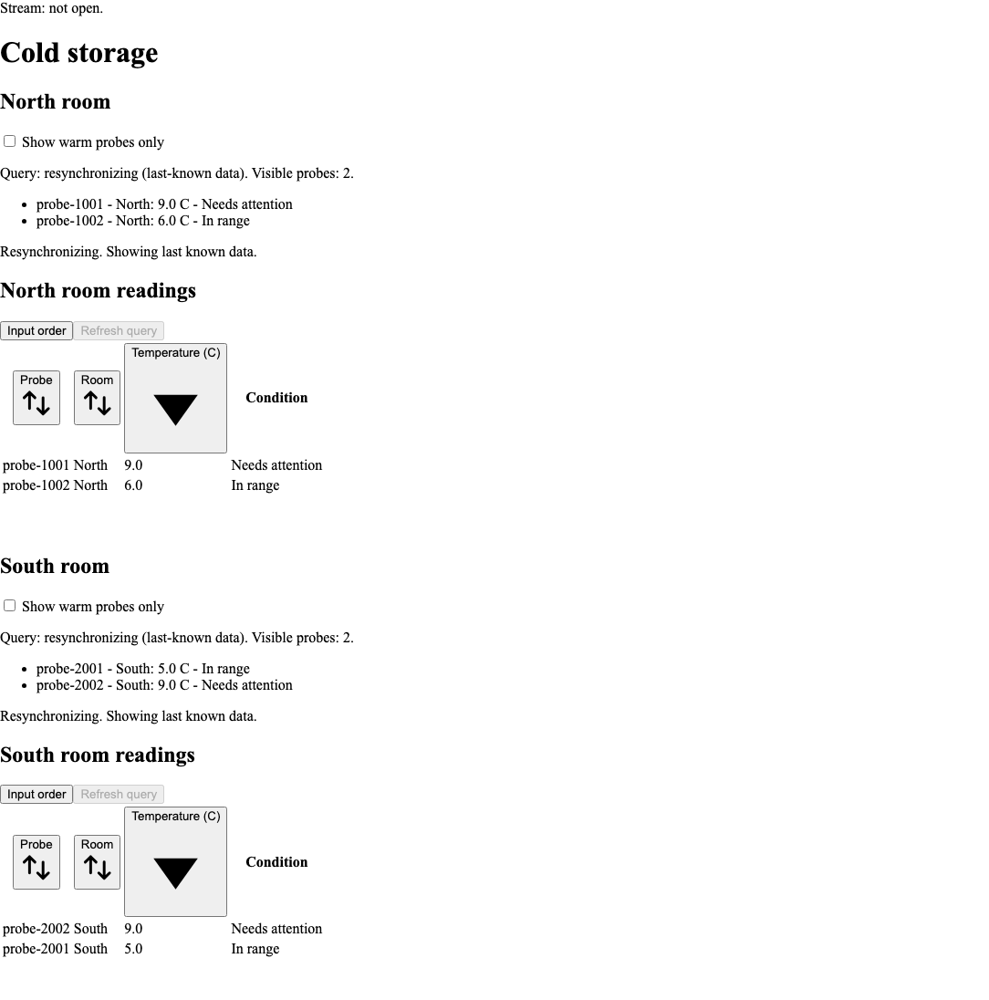

*Figure 15. Both snapshots and live changes pass through the exercise gateway's authentication.*

`getAccessToken` and `openAuthenticatedStream` are stable module-level
functions here. In a real parent component, use `useCallback` for a token
function that depends on a session service. Stable identity can still return
a fresh token on every call.

| Change | Lifecycle behavior |
| --- | --- |
| Equivalent inline query arrays, reaction objects, static headers, or reconnect settings | Retains the provider lifecycle |
| Material endpoint, instance, query set, credentials, or retry-policy change | Cancels old work and creates a replacement |
| New `fetch`, headers-provider, event-factory, or result-adapter callback identity | Replaces the connection owner |
| New query `getKey`, `transform`, or `postProcess` callback | Reprojects retained rows, without replacing the connection |

Use browser session cookies or your real authentication service in production;
keep service credentials server-side. Authenticate and authorize **both**
snapshot and SSE endpoints. Cross-origin cookies need an explicit CORS and
credential policy. Stop the exercise gateway with Ctrl+C when done.

**Summary.** Fresh credentials and stable callbacks solve different problems.
Apply the credentials on both transports and let one owner manage reconnects.

<a id="11-use-ssr-and-next-client-boundaries"></a>
### 13. Use SSR and Next client boundaries

**Goal:** render a Next route with a concrete client boundary.
**Prerequisites:** a Next App Router application and Chapter 6's modules.
This path is exercised with **Next 16.4.2**, **React/React DOM 19.3.1**,
**TypeScript 6.0.3**, `@types/react` / `@types/react-dom` **19.2.2**, and
`@types/node` **24.19.2**. Use the tested Node toolchains from Chapter 1.
Keep your Next manifest; do not replace it with the Vite starter.

Install the same React and core tarballs in that app, then copy these exact
files from your completed learning app:

| Destination | Source |
| --- | --- |
| `app/cold-storage/readings.ts` | `src/readings.ts` |
| `app/cold-storage/reading-model.ts` | `src/reading-model.ts` |
| `app/cold-storage/live-cold-storage.tsx` | `src/live-cold-storage.tsx` |
| `app/cold-storage/connection-notice.tsx` | `src/connection-notice.tsx` |
| `app/cold-storage/cold-storage-dashboard.tsx` | `src/cold-storage-dashboard.tsx` |

Create **`app/cold-storage/cold-storage-client.tsx`**:

```tsx
// @drasi-docs: cold-storage-client.tsx
'use client';
import { ColdStorageConnection, type Endpoints } from './live-cold-storage';
import { ColdStorageDashboard } from './cold-storage-dashboard';
import { ConnectionNotice } from './connection-notice';

export function ColdStorageClient({ serverUrl, endpoint }: Endpoints) {
  return <ColdStorageConnection serverUrl={serverUrl} endpoint={endpoint}>
    <ConnectionNotice /><ColdStorageDashboard />
  </ColdStorageConnection>;
}
```

Create **`app/cold-storage/page.tsx`**:

```tsx
// @drasi-docs: next-cold-storage-page.tsx
import { ColdStorageClient } from './cold-storage-client';

export default function Page() {
  return <ColdStorageClient serverUrl="http://127.0.0.1:8080"
    endpoint="http://127.0.0.1:8081/events" />;
}
```

For a new minimal app, this is the complete **`app/layout.tsx`**:

```tsx
// @drasi-docs: next-layout.tsx
import type { ReactNode } from 'react';
import '@drasi/react/styles.css';

export default function RootLayout({ children }: { children: ReactNode }) {
  return <html lang="en"><body>{children}</body></html>;
}
```

For an existing layout, retain its structure and add the stylesheet import.
Keep strict checking, `skipLibCheck: false`, `noEmit: true`, and
`moduleResolution: "bundler"` in Next's TypeScript configuration.
The extensionless imports work in both Vite and the actual Next build; neither
`allowImportingTsExtensions` nor a fabricated `.js` source file is needed.

Run your Next app's `next build`, then `next start --hostname 127.0.0.1`.
Open `/cold-storage`. These local URLs target the released backend directly;
use your app's authorized HTTPS routes and CORS policy when deploying.

**Change and observe.** Initial HTML contains **initial-loading**. Hydration
opens the browser connection and loads rows; sending a curl update changes
them. Inspect View Source to distinguish the prerendered loading view from
the hydrated result.

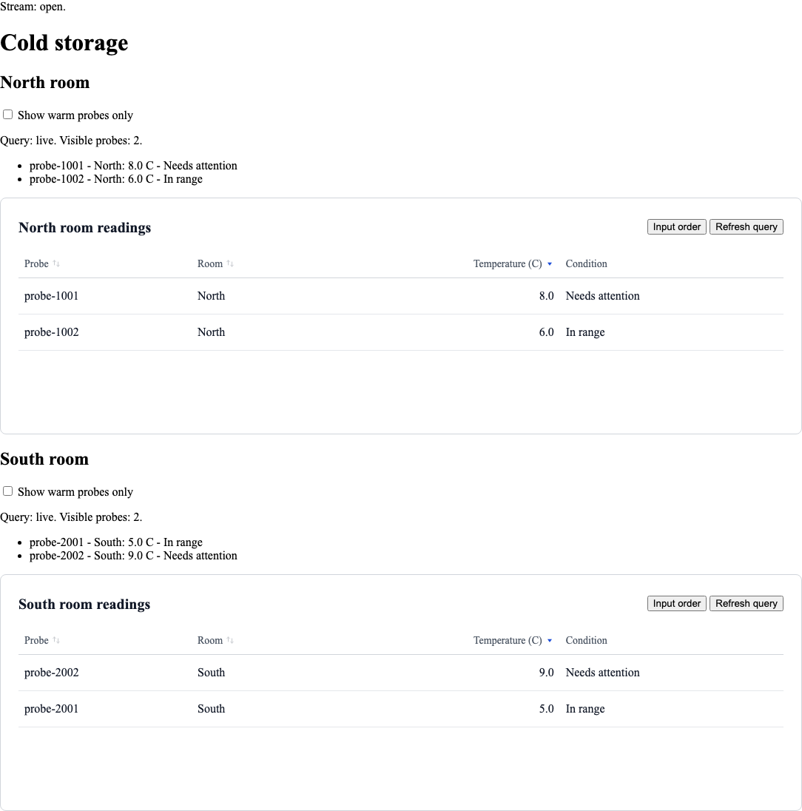

*Figure 16. The server renders the page boundary; the client owns live subscriptions.*

A provider-free `DataTable` can render known rows on the server. Live hooks
subscribe after client mount. Keep callback-valued props (`rowKey`, formatters,
event handlers) inside the client boundary; pass only serializable routing
values from the page.

Modal portals, focus management, and reduced-motion detection also start in
the browser. Deploy the lazy Modal chunk and keep an application error
boundary for loading failures. SSR-safe imports do not themselves open a
server-side subscription.

**Summary.** Share the same model and presentations, but make the browser
ownership boundary explicit.

<a id="12-test-debug-and-deploy"></a>
### 14. Test observable behavior

**Goal:** protect your application's identity and interaction rules.
**Prerequisites:** the completed local and live checkpoints.

Run `npm run build` after changes. Create **`identity.test.mjs`** at the app
root, then run `node --test identity.test.mjs`:

<!-- @drasi-guide-file: identity.test.mjs -->
```js
import assert from 'node:assert/strict';
import test from 'node:test';
import { accumulateResult } from '@drasi/ui-core';

test('an identity-only delete removes the current probe', () => {
  const key = raw => {
    if (typeof raw.probeId !== 'string' || !raw.probeId) throw new Error('Missing probeId');
    return raw.probeId;
  };
  const rows = accumulateResult([], {
    kind: 'snapshot', queryId: 'north-room', receivedAt: 0,
    rows: [{ probeId: 'probe-1001', room: 'North', temperatureC: 3 }],
  }, key);
  const after = accumulateResult(rows, {
    kind: 'delta', queryId: 'north-room', receivedAt: 1,
    changes: [{ kind: 'delete', before: { probeId: 'probe-1001' } }],
  }, key);
  assert.equal(rows.length, 1);
  assert.deepEqual(after, []);
});
```

Test your notification tracker with initial and resync snapshots, same-value
updates, cool-to-warm crossings, sparse deletes, and warm reinsertions. Test
the wrapper under StrictMode and after unmount. Assert that refresh and local
filter changes create no extra toast.

In browser tests, assert visible values and roles, keyboard sorting,
`aria-sort`, row movement, focus return, and error recovery. Record stream
openings and per-query reads: North's refresh should not refresh South or
replace the stream. Repeat critical exercises through the real proxy and
released backend as well as any deterministic fixtures.

**Summary.** Small domain tests and real browser exercises complement each
other. Test the behavior your users rely on, including cleanup.

<a id="diagnose-by-layer"></a>
### 15. Diagnose by layer

**Goal:** turn a typed error into an actionable correction.
**Prerequisites:** Chapter 10's failure lesson.

Use the code, not message text, as the discriminator. `terminal-error` means
automatic work stopped: the cause may be correctable configuration, a broken
callback, a repaired session, or an exhausted transient retry budget.

| Code | Meaning and remedy |
| --- | --- |
| `INVALID_CONFIGURATION` | Check URLs, identifiers, provider query membership, numeric retry settings, and native EventSource header limitations |
| `INSTANCE_NOT_FOUND`, `QUERY_NOT_FOUND`, `REACTION_NOT_FOUND` | Correct the reference or restore that resource in the backend setup |
| `INCOMPATIBLE_RESOURCE` | Check the reaction kind and whether it subscribes to every configured query |
| `RESOURCE_STARTING` | A resource is bootstrapping; bounded retry can wait for it |
| `RESOURCE_STOPPED`, `RESOURCE_UNAVAILABLE` | Start or repair the backend resource, then retry the appropriate scope |
| `SERVER_UNAVAILABLE` | Inspect the REST route, connectivity, timeout, and server status |
| `STREAM_UNAVAILABLE` | Inspect the SSE route, proxy streaming, heartbeat policy, credentials, and CORS |
| `UNAUTHENTICATED`, `FORBIDDEN` | Restore the session or correct authorized access on both transports |
| `INVALID_PAYLOAD` | Match the actual snapshot/wire envelope to the selected validating adapter |
| `UNROUTABLE_RESULT` | Preserve a usable query ID and an explicit adapter routing policy |
| `INVALID_ROW_KEY` | Correct `getKey`, including its handling of sparse deletes |
| `RESULT_PROCESSING_FAILED` | Correct a transform, derived-state callback, or result listener; refreshing broken code cannot fix it |
| `SNAPSHOT_OVERLAP`, `RESULT_BUFFER_OVERFLOW` | Changes overlapped a read; bounded resynchronization obtains a new baseline |

| Symptom | Inspect next |
| --- | --- |
| Unstyled controls | The explicit CSS import and delivered stylesheet |
| Invalid hook calls after an edit | One React identity, `optimizeDeps.include`, and a clean Vite optimization restart |
| Socket open but rows not ready | Query state and snapshot response; open transport is separate from readiness |
| Ghost rows after delete | Raw identity, rather than the render key or formatted fields |
| Reconnect on every parent render | Connection callback identities, rather than equivalent inline data objects |
| Stale dialog content | Store the selected key and find the current row |

Keep logs restricted to package versions, operations, typed error codes, and
the static field/reason diagnostics from Chapter 10. Inspect sensitive data
only through your application's authorized tools.

**Summary.** Correct the failing layer, then retry its scope.

<a id="deploy-the-application-not-a-development-server"></a>
### 16. Deploy the complete application

**Goal:** preserve working behavior outside the development server.
**Prerequisites:** the tested application and an authorized deployment host.

Run `npm run build` and deploy Vite's **entire `dist` directory**, including
CSS and shared/lazy chunks. A missing Modal chunk must not receive an HTML
route fallback. Set the appropriate base path for your host.

Vite's proxy configuration is development-only. Production needs its own
same-origin gateway or authorized HTTPS REST/SSE URLs. Stream
`text/event-stream` without buffering or caching, propagate upstream closure,
and verify your chosen heartbeat and idle-timeout contract. The client refuses
REST redirects, so configure the final read URL directly.

Authorize both transports and protect business writes independently.
Configure appropriate HTTPS, CSP `connect-src`, MIME, and framing policies.
Account for layout and portal styles in your tested CSP. Render untrusted
fields as React text rather than injecting HTML.

Each query hook retains raw rows and performs projection work. A visible
filter does not reduce that retained set; `maxPendingChanges` bounds overlap,
not total rows. Narrow queries upstream and measure realistic bursts, memory,
layout, and retry frequency on your target devices. The controls provide no
built-in virtualization or universal row-count promise.

**Summary.** Deploy all assets and qualify the real network path. Recheck
auth, recovery, keyboard use, zoom, and screen-reader behavior in your app.

<a id="13-capstone-a-cold-storage-dashboard"></a>
### 17. Capstone: a Cold storage dashboard

**Goal:** combine shared queries, reviews, themes, and scoped recovery.
**Prerequisites:** Chapters 3, 4, 6, and 10; a running backend.

Create **`src/cold-storage-capstone.tsx`**:

```tsx
// @drasi-docs: cold-storage-capstone.tsx
import { queryTableState } from '@drasi/react/components';
import { useDrasiClient, useDrasiConnectionStatus, useDrasiQuery } from '@drasi/react/react';
import { readingOptions } from './reading-model';
import { ReviewReadings } from './review-readings';
import { ConnectionNotice } from './connection-notice';

function Room({ queryId, title }: { queryId: string; title: string }) {
  const query = useDrasiQuery(queryId, readingOptions);
  const { retry: retryConnection } = useDrasiClient();
  const connection = useDrasiConnectionStatus();
  return <article>
    <p role="status">{title}: {query.status}{query.stale ? ' (last-known readings)' : ''}.</p>
    <dl aria-label={`${title} summary`}>
      <dt>Visible probes</dt><dd>{query.data === null ? 'Not loaded' : query.data.length}</dd>
      <dt>Need attention</dt><dd>{query.data === null ? 'Not loaded'
        : query.data.filter(row => row.celsius >= 8).length}</dd>
    </dl>
    <button type="button" onClick={query.retry} disabled={!connection.connected}>Refresh {title}</button>
    <ReviewReadings title={title} rows={query.data} state={queryTableState(query, retryConnection)} />
  </article>;
}
export function ColdStorageBoard() {
  return <main>
    <h1>Cold storage</h1>
    <ConnectionNotice />
    <div className="room-grid">
      <Room queryId="north-room" title="North room" />
      <Room queryId="south-room" title="South room" />
    </div>
  </main>;
}
```

Replace **`src/main.tsx`**:

```tsx
// @drasi-docs: capstone-main.tsx
import { StrictMode } from 'react';
import { createRoot } from 'react-dom/client';
import { ColdStorageConnection } from './live-cold-storage';
import { ColdStorageBoard } from './cold-storage-capstone';
import { ThemeScope } from './theme-scope';

const root = document.getElementById('root');
if (!root) throw new Error('Missing application root');
const origin = window.location.origin;
createRoot(root).render(<StrictMode>
  <ColdStorageConnection serverUrl={origin} endpoint={new URL('/events', origin).href}>
    <ThemeScope><ColdStorageBoard /></ThemeScope>
  </ColdStorageConnection>
</StrictMode>);
```

**Change and observe.** Send a warm update and compare the summary and table.
Refresh North and check that South performs no new snapshot read. Open a review
for `probe-2001`, then delete it:

```sh
curl --fail-with-body -H 'Content-Type: application/json' \
  -d '{"operation":"delete","id":"south-probe","labels":["Probe"]}' \
  http://127.0.0.1:8082/sources/probe-feed/events
```

The dialog shows **no longer in the current view**. Escape returns focus to
South's heading because its opener is gone. Restore it:

```sh
curl --fail-with-body -H 'Content-Type: application/json' \
  -d '{"operation":"insert","element":{"type":"node","id":"south-probe","labels":["Probe"],"properties":{"probeId":"probe-2001","room":"South","temperatureC":5}}}' \
  http://127.0.0.1:8082/sources/probe-feed/events
```

Stop and restart the backend. The shared `ConnectionNotice` includes the
**reconnecting** state, and each room labels retained readings while recovering.

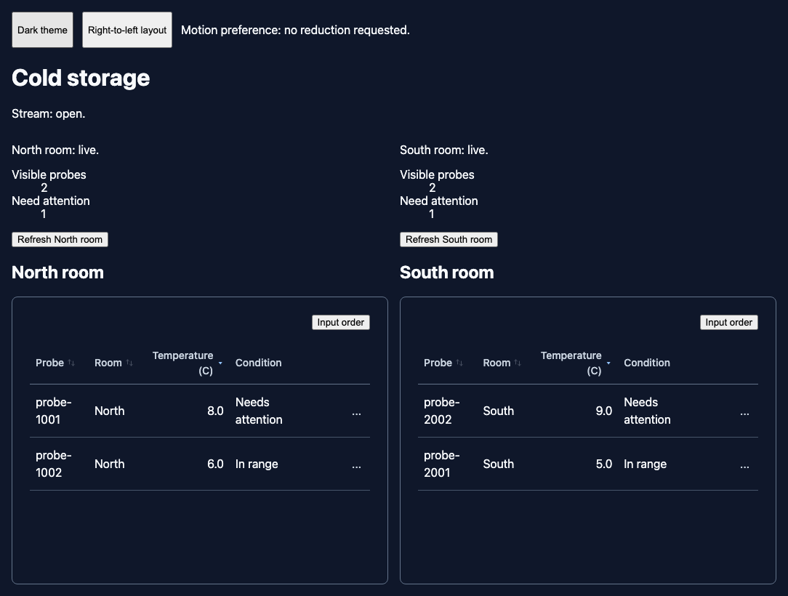

*Figure 17. One connection owner, one query per room, and multiple shared presentations.*

The repository's canonical React example uses this same backend dataset.
From its checkout, the complete real example is:

```sh
npm run build -w drasi-react-cold-storage-example &&
npm run start:live -w drasi-react-cold-storage-example
```

That command launches its own verified backend unless you explicitly supply
external service URLs. Its `/`, `/query-table.html`, and `/hooks.html` pages
compare the three presentations. `npm start` in that workspace is instead a
clearly labeled provider-free showcase.

**Summary.** You can now build local controls, run a real backend, distinguish
membership from row updates, react in code, and own the application's recovery
and deployment choices.

## Appendix A: Vocabulary

| Term | Meaning |
| --- | --- |
| Continuous query | A backend-maintained answer that changes with its input |
| Source | A backend component supplying changes, such as the HTTP source |
| Reaction | A backend result consumer; SSE delivers results to this app |
| Snapshot / baseline | Current rows accepted by one subscriber |
| Delta | An upsert, before/after update, or delete after/beside a snapshot |
| Projection | Validation and conversion from unknown fields to application rows |
| `getKey` / `rowKey` | Raw result identity / React render identity |
| Provider | A React binding to a client; the chosen owner controls its lifecycle |
| Subscription | An independent result baseline, recovery state, and stop handle |
| Stale | Useful last-good data while current work is recovering or failing |
| SSR / hydration | Initial server HTML followed by browser React ownership |

## Appendix B: Imports and reference

Use public entrypoints and one React/React DOM identity. The exercised renderer
versions are **18.3.1** and **19.3.1**; core and styles have no renderer peers.

| Import | Use |
| --- | --- |
| `@drasi/react/components` | Tables, Modal, state helpers, and typed columns/actions/slots |
| `@drasi/react/react` | Generic provider, query/status hooks, sorting and animation |
| `@drasi/react/adapters/drasi-server` | Server-owning provider and Server inspection bindings |
| `@drasi/ui-core` | Structural contracts, SSE, reducers, and query algorithms |
| `@drasi/ui-core/adapters/drasi-server` | Server read client, DTOs, and explicit wire adapters |
| `@drasi/react/client` | Data-only compatibility re-export of core |
| `@drasi/react` | Generic convenience exports, including core types; Server adapters are separate |
| `@drasi/react/styles.css` | Explicit control CSS |
| `@drasi/ui-styles/styles.css` | Alternative shared CSS for mixed-framework applications |

The [reference index](../reference/README.md) provides detailed
[DataTable](../reference/data-table.md), [QueryTable](../reference/query-table.md),
[Modal](../reference/modal.md), [bindings](../reference/bindings.md),
[styles](../reference/styles.md), [core](../reference/core.md),
[Server client](../reference/server-client.md), and
[Server provider](../reference/server-provider.md) contracts.
Essential setup is inline in this book; these references provide deeper lookup.
The book, figures, backend helper, and reference copies are available offline
inside the installed package.

**Reading on paper.** A prepared preview includes an offline
`developer-guide.html` with wrapped code, embedded screenshots, and text-first
diagram alternatives that preserve flow, transitions, and sequence branches.
From the source checkout you can produce the same edition with
`npm run docs:print`, then open `.artifacts/react-developer-guide.html` and use
your browser's Print command. Captions and source notes travel with the book.

## Appendix C: Installation after publication

**Use these commands only once an npm release actually exists.** Until then,
Chapter 1's verified tarballs are the executable route.

For this guide's app, which directly imports both React and core:

```sh
# @drasi-install: react
npm install @drasi/react @drasi/ui-core
```

For a renderer-free client and shared stylesheet:

```sh
# @drasi-install: core
npm install @drasi/ui-core @drasi/ui-styles
```

Applications importing only React's public re-exports can depend only on
`@drasi/react`. Declare every package your own code imports, including with
pnpm. Keep your application lockfile and import CSS explicitly.

For **pnpm 12.14.0 with unpublished tarballs**, also map React's exact internal
core version to the same verified archive. In the app root, create
`pnpm-workspace.yaml` (adjust the file path to your download location):

```yaml
overrides:
  "@drasi/ui-core@0.1.0-beta.1": "file:../drasi-ui/.artifacts/learning/drasi-ui-core-0.1.0-beta.1.tgz"
```

Then use `pnpm add` with the same two tarball paths from Chapter 1 and run
`pnpm run build`. This mapping is for the verified, version-matching unpublished
sibling only; it changes no React peer range. Once the cohort is published,
ordinary registry installation no longer needs that mapping.

<a id="8-own-a-client-without-drasi-server"></a>
## Appendix D: Bring your own gateway

**Goal:** connect an existing application service without Server resource DTOs.
**Prerequisites:** that service must already provide the endpoints below.
This advanced adapter is an alternative to Part II's Server binding, not a
second query engine or an implementation of these service endpoints.

| Endpoint | Application-owned contract |
| --- | --- |
| `GET /cold-storage/queries/{queryId}` | JSON `{ "rows": [...] }` with the current object rows |
| `GET /cold-storage/events` | SSE with normalized application upsert/update/delete JSON |
| Both routes | Enforce the application's authorized session |

A stream result's `data` can be:

```json
{"queryId":"north-room","op":"upsert","after":{"probeId":"probe-1001","room":"North","temperatureC":8}}
```

An `update` has object-valued `before` and `after`; a `delete` has `before`,
possibly only `{ "probeId": "probe-1001" }`. A heartbeat is
`{ "type": "heartbeat", "ts": 123 }`.
The transport accepts **unnamed `message` events** and **named `query-result`
events**. Other event names are ignored; naming a result `update` will not route
it. Use a validating adapter for the data envelope.

Create **`src/application-client.ts`**:

```ts
// @drasi-docs: application-client.ts
import { SSEClient, DrasiError, asDrasiError, subscribeToQuery,
  type EventSourceFactory, type QueryClient, type QuerySubscription,
  type ResultAdapter, type ResultChange, type ResultRow } from '@drasi/ui-core';

const queryIds = ['north-room', 'south-room', 'warm-probes'];
const object = (value: unknown): value is ResultRow =>
  value !== null && typeof value === 'object' && !Array.isArray(value);
export const applicationEvents: ResultAdapter = (payload, context) => {
  const invalid = () => new DrasiError('INVALID_PAYLOAD', context);
  if (!object(payload)) throw invalid();
  if (payload.type === 'heartbeat') {
    if (typeof payload.ts !== 'number' || !Number.isFinite(payload.ts)) throw invalid();
    return [];
  }
  if (typeof payload.queryId !== 'string' || !queryIds.includes(payload.queryId)) {
    throw new DrasiError('UNROUTABLE_RESULT', context);
  }
  const row = (value: unknown): ResultRow => {
    if (!object(value)) throw invalid();
    return value;
  };
  let change: ResultChange;
  switch (payload.op) {
    case 'upsert': change = { kind: 'upsert', after: row(payload.after) }; break;
    case 'update': change = { kind: 'update', before: row(payload.before), after: row(payload.after) }; break;
    case 'delete': change = { kind: 'delete', before: row(payload.before) }; break;
    default: throw invalid();
  }
  return [{ kind: 'delta', queryId: payload.queryId, changes: [change], receivedAt: context.receivedAt }];
};

export function createApplicationClient(origin: string, transport: {
  fetch?: typeof fetch; eventSourceFactory?: EventSourceFactory;
} = {}) {
  const url = new URL(origin);
  if (!['http:', 'https:'].includes(url.protocol) || url.origin !== origin) {
    throw new DrasiError('INVALID_CONFIGURATION');
  }
  const stream = new SSEClient({
    resultAdapter: applicationEvents, eventSourceFactory: transport.eventSourceFactory,
    credentials: 'same-origin',
  });
  const request = transport.fetch ?? globalThis.fetch.bind(globalThis);
  const subscriptions = new Set<QuerySubscription>();
  async function snapshot(queryId: string, signal: AbortSignal): Promise<ResultRow[]> {
    const details = { resourceKind: 'query', resourceId: queryId } as const;
    let status: number | undefined;
    try {
      const response = await request(new URL(`/cold-storage/queries/${encodeURIComponent(queryId)}`, origin), {
        method: 'GET', credentials: 'same-origin', redirect: 'error',
        headers: { Accept: 'application/json' },
        signal: AbortSignal.any([signal, AbortSignal.timeout(10_000)]),
      });
      status = response.status;
      if (!response.ok) throw new DrasiError(
        status === 401 ? 'UNAUTHENTICATED' : status === 403 ? 'FORBIDDEN'
          : status === 408 || status === 429 || status >= 500 ? 'SERVER_UNAVAILABLE' : 'INVALID_PAYLOAD',
        { ...details, status });
      let body: unknown;
      try { body = await response.json(); }
      catch (error) {
        if (error instanceof SyntaxError) throw new DrasiError('INVALID_PAYLOAD', { ...details, status });
        throw error;
      }
      if (!object(body) || !Array.isArray(body.rows) || !body.rows.every(object)) {
        throw new DrasiError('INVALID_PAYLOAD', { ...details, status });
      }
      return body.rows;
    } catch (error) {
      if (signal.aborted) throw signal.reason;
      throw asDrasiError(error, { ...details, status }, 'SERVER_UNAVAILABLE');
    }
  }
  const client: QueryClient = {
    getConnectionStatus: () => stream.getConnectionStatus(),
    onConnectionStatusChange: callback => stream.onConnectionStatusChange(callback),
    subscribe(queryId, onResult, onError, onStateChange) {
      if (!queryIds.includes(queryId)) throw new DrasiError('INVALID_CONFIGURATION');
      let subscription: QuerySubscription | undefined;
      subscription = subscribeToQuery({
        queryId, source: stream, snapshot: signal => snapshot(queryId, signal),
        details: { resourceKind: 'query', resourceId: queryId },
        maxRetries: 10, retryDelay: 1000, maxRetryDelay: 30_000, maxPendingChanges: 10_000,
        onStop: () => { if (subscription) subscriptions.delete(subscription); },
      }, onResult, onError, onStateChange);
      subscriptions.add(subscription);
      return subscription;
    },
  };
  return {
    client,
    connect: () => stream.connect(queryIds, new URL('/cold-storage/events', origin).href),
    dispose: async () => {
      for (const subscription of subscriptions) subscription();
      await stream.disconnect();
    },
  };
}
```

Create **`src/application-connection.tsx`**:

```tsx
// @drasi-docs: application-connection.tsx
import { useCallback, useEffect, useMemo, useState, type ReactNode } from 'react';
import { DrasiClientProvider, type DrasiContextValue } from '@drasi/react/react';
import { asDrasiError, isAbortError } from '@drasi/ui-core';
import { createApplicationClient } from './application-client';

export function ApplicationConnection({ origin, children }: { origin: string; children: ReactNode }) {
  const [attempt, setAttempt] = useState(0);
  const retry = useCallback(() => setAttempt(value => value + 1), []);
  const scope = useMemo(() => ({ origin, attempt }), [origin, attempt]);
  const [state, setState] = useState<{ scope: typeof scope; value: DrasiContextValue } | null>(null);
  useEffect(() => {
    let owner: ReturnType<typeof createApplicationClient>;
    try { owner = createApplicationClient(scope.origin); }
    catch (error) {
      setState({ scope, value: {
        client: null, initialized: false, error: asDrasiError(error, {}, 'INVALID_CONFIGURATION'), retry,
      } });
      return;
    }
    let active = true, initialized = false;
    const publish = () => {
      const status = owner.client.getConnectionStatus();
      if (active) setState({ scope, value: {
        client: owner.client, initialized,
        error: status.reconnecting ? null : status.error ?? null, retry,
      } });
    };
    const stopStatus = owner.client.onConnectionStatusChange(publish);
    void owner.connect().then(() => { initialized = true; publish(); }).catch(error => {
      if (active && !isAbortError(error)) setState({ scope, value: {
        client: owner.client, initialized: false, error: asDrasiError(error), retry,
      } });
    });
    return () => {
      active = false;
      stopStatus();
      void owner.dispose().catch(error => console.error('Cold storage cleanup failed:', asDrasiError(error).code));
    };
  }, [scope, retry]);
  const value: DrasiContextValue = state?.scope === scope ? state.value
    : { client: null, initialized: false, error: null, retry };
  return <DrasiClientProvider value={value}>{children}</DrasiClientProvider>;
}
```

Use this complete **`src/main.tsx`** checkpoint when your service exposes the
gateway contract on the application's origin:

```tsx
// @drasi-docs: application-main.tsx
import { StrictMode } from 'react';
import { createRoot } from 'react-dom/client';
import { ApplicationConnection } from './application-connection';
import { ColdStorageDashboard } from './cold-storage-dashboard';

const root = document.getElementById('root');
if (!root) throw new Error('Missing application root');
createRoot(root).render(<StrictMode>
  <ApplicationConnection origin={window.location.origin}><ColdStorageDashboard /></ApplicationConnection>
</StrictMode>);
```

The owner creates, connects, retries, and disposes the client. The generic
`DrasiClientProvider` only binds its value. Each subscription supplies a
callable stop handle with `retry()` and `getState()`, and publishes current
connection/query state. Keep this contract when adapting your service.

**Summary.** A structural client lets the same hooks and presentations work
with your service, while keeping service-specific wire validation and
connection ownership explicit.

## Source notes

[^tools]: Vite 7.3.7 declares Node `^20.19.0 || >=22.12.0`; the book qualifies
    22.20.0 and 24.19.0 rather than claiming every permitted version was tested.
    React's browser packages and maintainer tooling have different requirements.
    The pinned manifests and lockfile in the source checkout record the exact
    build inputs.

[^server]: Drasi Server's real
    [0.2.4 release](https://github.com/drasi-project/drasi-server/releases/tag/0.2.4)
    supplies
    [macOS arm64](https://github.com/drasi-project/drasi-server/releases/download/0.2.4/drasi-server-aarch64-apple-darwin)
    and
    [Linux x64 glibc](https://github.com/drasi-project/drasi-server/releases/download/0.2.4/drasi-server-x86_64-linux-gnu)
    binaries. Server source is `a977b6125395f9abbbee4a1f271ca6f84d17daed`.
    Plugin source is `22125bf1d66062533b832a166fe4a51079a23d6e`;
    [its reviewed Server-side pins](https://github.com/drasi-project/drasi-server/blob/a977b6125395f9abbbee4a1f271ca6f84d17daed/examples/trading/app/test/live/plugins-darwin-arm64.lock)
    record the signed component versions. The launcher carries the exact release
    and plugin checksums, verifies them automatically, and records its own run.
    Earlier compatibility evidence remains under its original versions in the
    [compatibility reference](../reference/validation.md#verified-compatibility).

[^feed]: The released HTTP source's
    [event model](https://github.com/drasi-project/drasi-core/blob/22125bf1d66062533b832a166fe4a51079a23d6e/components/sources/http/src/models.rs)
    defines `insert` / `update` with an `element`, `delete` with an `id` and
    optional labels, and an optional nanosecond timestamp. These exercises omit
    the timestamp and use the source's current-time behavior. Screenshots in
    this book are captured from the running local lessons and released backend;
    diagrams describe the protocol rather than substitute for those runs.
