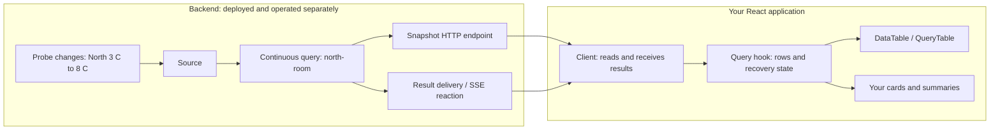

# The React developer guide

**Drasi's React controls turn changing data into useful screens.** Use a table
with rows you already own, or connect a screen to the maintained results of a
Drasi query. You can keep the table, replace it with your own cards, or show
several presentations of the same data. The library supplies the connection
binding, query state, table behavior, and dialog primitive; your application
owns its layout, authentication, row meaning, and business actions.

This book teaches that journey by building **Cold storage**, a dashboard for
temperature probes in two rooms. You will start with a complete local screen,
change a reading, connect the same presentation to changing query results,
add review dialogs, and prepare the application for deployment. Cold storage
uses the same domain and query names as this repository's canonical example,
not a second example catalog.

You should know React, JavaScript or TypeScript, and how to run an npm command.
No prior knowledge of Drasi, event streams, providers, or graph databases is
assumed. Read in order the first time; the contents and reference appendix make
later visits quick. Everything needed for the browser lessons is in this book.
Backend deployment is a separate, explicitly identified operator prerequisite.

## Understand what runs where

A **continuous query** is a question whose answer Drasi maintains as source
data changes. Instead of repeatedly asking "what are all the readings now?",
you can receive changes to that answer. A **source** brings changes into the
backend. A query selects, joins, or summarizes them. A delivery component makes
the result available to your application; in the optional Drasi Server
integration, that component is an **SSE reaction**.

**SSE**, or server-sent events, is a long-lived HTTP response carrying messages
from a server to a browser. It is a delivery mechanism, not the query engine.
An **initial snapshot** supplies the current result rows. Later **changes**
add, replace, or remove rows in the browser's view.



Trace one real change before choosing an API:

1. Probe `probe-1001` reports **8 C**, replacing its previous **3 C** reading.
2. Drasi updates the `north-room` query's answer. Its projected row includes
   `probeId`, `room`, and `temperatureC`. A query that only selected warm probes
   could instead add the probe to its answer at this point.
3. The browser client receives the result change, identifies the existing raw
   row by `probeId`, and updates the retained result set.
4. A hook validates and converts that row to your `Reading` type. React renders
   **8.0 C** and **Needs attention**. The browser did not execute the query or
   deploy a resource.

A **provider** is a React context binding that makes a client available to
descendant hooks. A **hook** turns that client's result notifications into React
state. A **component** renders that state. These are distinct responsibilities:
putting a provider around React does not run a Drasi engine inside the page.

Choose the path that matches your application:

| Your starting point | What you configure | What you do not need |
| --- | --- | --- |
| **Display my own data** | Rows, typed columns, a stable render key, and CSS | A provider, query, backend, or network connection |
| **Connect to an existing Drasi query** | A client binding, existing query ID, raw row identity, and validation/projection | Resource creation inside a React component |
| **Use the optional Drasi Server integration** | Existing instance/query/reaction references and browser-reachable HTTP/SSE URLs | A custom implementation of Server's read protocol |
| **Use an application-owned data service** | A structural client that implements the documented subscription contract | A Server superclass, Server DTOs, or administration API |

The controls do not provision resources, choose an instance, manage arbitrary
drasi-lib applications because a port is open, or give a browser permission to
mutate a backend. The native drasi-lib computation-graph guide describes a
different backend API; its existence is not proof of Server-adapter
compatibility. [Chapter 8](#8-own-a-client-without-drasi-server) shows the
non-Server path without pretending those APIs are interchangeable.

## Contents

**Part I - Build a useful screen**

1. [Run your first screen](#1-run-your-first-screen)
2. [Model rows and preserve identity](#2-model-rows-and-preserve-identity)
3. [Control sorting and presentation](#3-control-sorting-and-presentation)

**Part II - Work with changing results**

4. [Connect to an existing query](#4-connect-to-an-existing-query)
5. [Share one query across presentations](#5-share-one-query-across-presentations)
6. [Keep failures and recovery visible](#6-keep-failures-and-recovery-visible)
7. [Add actions and a review dialog](#7-add-actions-and-a-review-dialog)

**Part III - Own the application**

8. [Own a client without Drasi Server](#8-own-a-client-without-drasi-server)
9. [Authenticate and reconfigure safely](#9-authenticate-and-reconfigure-safely)
10. [Theme an accessible, responsive screen](#10-theme-an-accessible-responsive-screen)
11. [Use SSR and Next client boundaries](#11-use-ssr-and-next-client-boundaries)
12. [Test, debug, and deploy](#12-test-debug-and-deploy)
13. [Capstone: a Cold storage dashboard](#13-capstone-a-cold-storage-dashboard)

[Appendix A: Vocabulary](#appendix-a-vocabulary) |
[Appendix B: Imports and reference](#appendix-b-imports-and-reference) |
[Appendix C: Installation after publication](#appendix-c-installation-after-publication)

## Part I - Build a useful screen

### 1. Run your first screen

Build a screen that displays two readings. Press **Warm North** and see one
temperature change. This first lesson is deliberately local: it needs neither
a backend nor a simulation pretending to be a live Drasi connection.

#### Get installable artifacts

**The npm packages are not published yet.** Do not start by installing
`@drasi/react` from the registry. The executable prepublication route is to build
the three packages and install their actual tarballs. You need Node **24.19.0**,
npm **11.17.0**, Git, and access to the official npm registry for dependencies.
No Rust compiler, plugin, or drasi-server checkout is involved.

In a directory where `drasi-ui` and `cold-storage` do not already exist:

```sh
git clone https://github.com/drasi-project/drasi-ui.git drasi-ui
cd drasi-ui
npm ci
npm run build
DRASI_CANDIDATES=.artifacts/learning npm run pack:candidates
cd ..
mkdir cold-storage
cd cold-storage
mkdir src
```

In PowerShell, set `$env:DRASI_CANDIDATES = '.artifacts/learning'` before
`npm run pack:candidates`, then `Remove-Item Env:DRASI_CANDIDATES`; run the other
commands normally. Packing will not overwrite an existing candidate directory.
Use a new directory name and adjust the install paths if you repeat this step.
These are local learning archives, not a publication or a release approval.

If a maintainer supplied a verified set of the three tarballs, skip cloning and
building: create the app directory and substitute their paths below. Keep all
three at the same supplied version. The filenames below match the current
`0.1.0-beta.1` preparation version; no availability on npm is implied.

#### Create the application

Create these four files. The complete screen follows them. The special comments
identify examples that this repository checks against installed packages; they
are harmless to keep in your copy.

**`package.json`**

<!-- @drasi-guide-file: package.json -->
```json
{
  "name": "cold-storage-learning",
  "version": "0.0.0",
  "private": true,
  "type": "module",
  "scripts": {
    "dev": "vite --host 127.0.0.1",
    "build": "tsc --noEmit && vite build"
  },
  "dependencies": {
    "@drasi/react": "0.1.0-beta.1",
    "@drasi/ui-core": "0.1.0-beta.1",
    "@drasi/ui-styles": "0.1.0-beta.1",
    "react": "18.3.1",
    "react-dom": "18.3.1"
  },
  "devDependencies": {
    "@types/react": "18.3.31",
    "@types/react-dom": "18.3.7",
    "esbuild": "0.28.1",
    "typescript": "5.9.3",
    "vite": "7.3.7"
  }
}
```

**`tsconfig.json`**

<!-- @drasi-guide-file: tsconfig.json -->
```json
{
  "compilerOptions": {
    "target": "ES2022",
    "lib": ["ES2022", "DOM", "DOM.Iterable"],
    "module": "ESNext",
    "moduleResolution": "Bundler",
    "jsx": "react-jsx",
    "strict": true,
    "skipLibCheck": false,
    "allowImportingTsExtensions": true,
    "noUncheckedSideEffectImports": true,
    "noEmit": true,
    "types": []
  },
  "include": ["src"]
}
```

**`index.html`**

<!-- @drasi-guide-file: index.html -->
```html
<!doctype html>
<html lang="en">
  <head>
    <meta charset="UTF-8" />
    <meta name="viewport" content="width=device-width, initial-scale=1" />
    <title>Cold storage</title>
  </head>
  <body>
    <div id="root"></div>
    <script type="module" src="/src/main.tsx"></script>
  </body>
</html>
```

**`src/main.tsx`**

```tsx
// @drasi-docs: cold-storage-main.tsx
import { StrictMode } from 'react';
import { createRoot } from 'react-dom/client';
import { ColdStorage } from './cold-storage.tsx';

const root = document.getElementById('root');
if (!root) throw new Error('Missing application root');
createRoot(root).render(<StrictMode><ColdStorage /></StrictMode>);
```

**`src/cold-storage.tsx`**

```tsx
// @drasi-docs: cold-storage.tsx
import { useState } from 'react';
import { DataTable, type ColumnDef } from '@drasi/react/components';
import '@drasi/react/styles.css';

interface Reading { key: string; room: 'North' | 'South'; celsius: number }
const initialRows: readonly Reading[] = [
  { key: 'probe:probe-1001', room: 'North', celsius: 3 },
  { key: 'probe:probe-2001', room: 'South', celsius: 5 },
];
const columns: readonly ColumnDef<Reading>[] = [
  { key: 'room', label: 'Room' },
  {
    key: 'celsius', label: 'Temperature (C)', align: 'right',
    format: (_value, row) => row.celsius.toFixed(1),
  },
  {
    key: 'condition', label: 'Condition', sortable: false,
    format: (_value, row) => row.celsius >= 8 ? 'Needs attention' : 'In range',
  },
];

export function ColdStorage() {
  const [rows, setRows] = useState(initialRows);
  return <main style={{ maxWidth: '60rem', margin: '2rem auto', fontFamily: 'system-ui' }}>
    <h1>Cold storage</h1>
    <p>Local readings. These buttons change this page only; no backend is connected.</p>
    <button type="button" onClick={() => setRows(current => current.map(row =>
      row.room === 'North' ? { ...row, celsius: 8 } : row,
    ))}>Warm North</button>
    <button type="button" onClick={() => setRows(initialRows)}>Reset readings</button>
    <DataTable<Reading>
      title="Room readings" rows={rows} columns={columns} rowKey={row => row.key}
      animateOnChange="celsius" height="20rem"
    />
  </main>;
}
```

Now install the **local files**, not the unavailable registry package, and run:

```sh
npm install ../drasi-ui/.artifacts/learning/drasi-ui-core-0.1.0-beta.1.tgz ../drasi-ui/.artifacts/learning/drasi-ui-styles-0.1.0-beta.1.tgz ../drasi-ui/.artifacts/learning/drasi-react-0.1.0-beta.1.tgz
npm run build
npm run dev
```

Open the URL printed by Vite, normally `http://127.0.0.1:5173`. Keep that
terminal running while editing files. These application modules import explicit
`.ts`/`.tsx` source paths, as Vite and Next can resolve them directly. The
`allowImportingTsExtensions` option is paired with `noEmit`: TypeScript checks
the code, while the application bundler emits JavaScript. This is a browser
application, not a set of precompiled Node modules.

**Change and observe.** North begins at **3.0**, South at **5.0**, both in range.
Press **Warm North**: North becomes **8.0** and **Needs attention**. Press
**Reset readings** to restore the original values. Click **Temperature (C)** to
sort ascending, then again for descending. Enable your operating system's
reduced-motion preference: values still update, without the row flash.

**Why it works.** `DataTable` renders your rows; `useState` owns them. The update
replaces one object without mutating the old array. `rowKey` lets React recognize
the same probe after a change or sort. The explicit CSS import supplies scoped
control styles, without Tailwind or source scanning. There is no provider and
no network request to Drasi.

Save the application lockfile. After a release is approved,
[ordinary registry installation](#appendix-c-installation-after-publication)
replaces only the tarball installation step, not the programming model.

### 2. Model rows and preserve identity

Next, separate the row meaning from its presentation. The source system uses
`probeId` and `temperatureC`; the screen uses `key` and `celsius`. A **projection**
is the function that validates a raw row and converts it into your application
type. A TypeScript generic alone does not validate data received over HTTP.

Create **`src/reading-model.ts`**. Later chapters import this same file:

```ts
// @drasi-docs: reading-model.ts
import type { RowKey } from '@drasi/ui-core';
import type { UseDrasiQueryOptions } from '@drasi/react/react';
import type { ColumnDef } from '@drasi/react/components';

export interface Reading { key: string; room: 'North' | 'South'; celsius: number }
export const rowKey = (row: Reading) => row.key;

export const probeKey: RowKey = raw => {
  if (typeof raw.probeId !== 'string' || !raw.probeId.trim()) {
    throw new Error('Expected a nonempty probeId, including on deletes');
  }
  return raw.probeId;
};

export const readingOptions: UseDrasiQueryOptions<Reading> = {
  getKey: probeKey,
  transform: raw => {
    const probeId = probeKey(raw);
    if ((raw.room !== 'North' && raw.room !== 'South') ||
        typeof raw.temperatureC !== 'number' || !Number.isFinite(raw.temperatureC)) {
      throw new Error('Expected a room and finite temperatureC');
    }
    return { key: `probe:${probeId}`, room: raw.room, celsius: raw.temperatureC };
  },
};

export const columns: readonly ColumnDef<Reading>[] = [
  { key: 'room', label: 'Room' },
  {
    key: 'celsius', label: 'Temperature (C)', align: 'right',
    format: (_value, row) => row.celsius.toFixed(1),
  },
  {
    key: 'condition', label: 'Condition', sortable: false,
    format: (_value, row) => row.celsius >= 8 ? 'Needs attention' : 'In range',
  },
];
```

To use the shared columns in the first screen, remove its local `Reading`
interface and `columns` declaration, remove `type ColumnDef` from the component
import, and add `import { columns, type Reading } from './reading-model.ts';`.
Keep its local `initialRows` and `useState`. Change the column formatter to
`row.celsius.toFixed(2)` and save: **3.00** appears without changing the value
used for sorting. Return it to one decimal place before continuing.

There are **two identities**, for different jobs:

| Identity | Input | Job |
| --- | --- | --- |
| `getKey`, here `probeKey` | Raw rows, including sparse deletes | Maintain the result set as changes arrive |
| `rowKey` | Projected `Reading` objects | Preserve rendered rows, focus, and animation identity |

A delete might contain only `{ probeId: 'probe-1001' }`. It has enough identity
to remove the retained raw row, even though it has no temperature to format.
Deletes **never** pass through `transform`. An update with a changed key removes
its old key before storing its new row. Array indices, timestamps, serialized
row values, and Server `row_signature` numbers are not suitable substitutes.

The `format` callback's first argument is `unknown`: a column may use a computed
key such as `condition`, rather than a property of `Reading`. Use the typed
second argument, or narrow the value. Computed display text does not create a
sortable property, so this condition column explicitly disables sorting.

A transform can return `null` to hide a row, and `postProcess` can derive a
sorted or filtered view. Neither evicts the raw row. A later update or committed
option change can make it visible again. Throwing is different from hiding:
invalid data becomes a visible typed error, not a silently missing reading.

### 3. Control sorting and presentation

Build a local screen whose sort is application-owned. This makes it possible
to keep an explicit **Input order** control or share the same sort between
presentations. Create **`src/sorted-cold-storage.tsx`**:

```tsx
// @drasi-docs: sorted-cold-storage.tsx
import { DataTable } from '@drasi/react/components';
import { useTableSort } from '@drasi/react/react';
import { columns, rowKey, type Reading } from './reading-model.ts';
import '@drasi/react/styles.css';

const rows: readonly Reading[] = [
  { key: 'probe:probe-1001', room: 'North', celsius: 8 },
  { key: 'probe:probe-2001', room: 'South', celsius: 5 },
];

export function SortedColdStorage() {
  const sorting = useTableSort({ defaultSort: { column: 'celsius', direction: 'desc' } });
  return <main>
    <h1>Cold storage</h1>
    <DataTable<Reading>
      title="Room readings" rows={rows} columns={columns} rowKey={rowKey}
      sort={sorting.sort} onSortChange={sorting.setSort}
      headerControls={<button type="button" onClick={() => sorting.setSort(null)}>
        Input order
      </button>}
      headerSlot={<p>Warmest first until you choose another order.</p>}
      renderEmpty={() => <span>No probes in this view.</span>}
      height="20rem"
    />
  </main>;
}
```

In `src/main.tsx`, import `SortedColdStorage` from `./sorted-cold-storage.tsx`
instead of `ColdStorage`, and render `<SortedColdStorage />`. North starts first.
Click **Temperature (C)** to put South first; **Input order** restores North.
Tab to the header button and use Enter or Space: the same sort applies.

`sort={null}` is a controlled, unsorted value; `sort={undefined}` means the
table manages its own sort. In controlled mode the owner must apply requests,
as `sorting.setSort` does here. `defaultSort` is read only on mount. A header
toggles ascending/descending, not a three-state cycle; clearing is explicit.
The table copies rows before sorting and does not reorder your input array.

Numeric values sort numerically, not by their formatted strings. Text uses a
fixed English collation policy; nullish values come last ascending and first
descending. Hidden properties can sort, but a formatter is not a comparator.
See the [exact ordering contract](../reference/data-table.md#sorting) when
mixed types or cross-runtime collation matter.

Slots replace presentation, not ownership. `headerSlot` is content below the
header; `renderHeader` replaces the header and can call `defaultRender()`.
`renderEmpty` runs *inside* a spanning table cell, so return content, not a
`tr` or `td`. A replacement `renderRow` must retain valid table-row semantics.
A slot returning `null` deliberately suppresses its default.

## Part II - Work with changing results

### 4. Connect to an existing query

Replace the local array with a real maintained query result. Use the optional
Drasi Server adapter when your operator exposes its supported instance-scoped
REST API and SSE reaction protocol. This chapter is **not runnable against a
random drasi-lib port**, and it does not install or start backend resources.

#### Agree on the backend contract

An operator supplies these **existing, running** resources:

| Resource | Cold storage contract |
| --- | --- |
| Instance | `cold-chain` |
| Source | `probe-feed`, supplying `Probe` nodes with `probeId`, `room`, and `temperatureC` |
| Queries | `north-room` and `south-room`, each projecting those three fields |
| SSE reaction | `cold-chain-events`, kind `sse`, subscribed to both queries |
| REST URL | Browser/proxy-reachable base serving `/api/v1/instances/cold-chain/...` |
| SSE URL | Browser/proxy-reachable stream endpoint, for this example `/events` |

The North query is:

```cypher
MATCH (p:Probe)
WHERE p.room = 'North'
RETURN p.probeId AS probeId, p.room AS room, p.temperatureC AS temperatureC
```

The South query substitutes `'South'`. Initial sample readings are North
`probe-1001` at **3 C** and South `probe-2001` at **5 C**. The repository's
[operator configuration](https://github.com/drasi-project/drasi-ui/blob/main/examples/react/config/server.yaml)
and [initial feed](https://github.com/drasi-project/drasi-ui/blob/main/examples/react/config/readings.jsonl)
contain the concrete deployment inputs. The operator replaces port markers,
selects and verifies released binaries/plugins, and mounts the feed file; the
control package performs none of those steps. Those deployment inputs are not
the full-view read responses expected by the client.

The default adapter accepts the recorded **untemplated** SSE result envelope.
If the operator enables a custom template, agree on a validating adapter rather
than hoping the client guesses the format. The
[templated-reaction reference](../reference/server-client.md#handlebars-sse-to-querytable)
preserves the complete template/adapter recipe. The supported read/wire
contracts and historical version evidence are in that reference and the
[compatibility reference](../reference/validation.md#verified-compatibility).

For a local backend whose REST and SSE listeners are on **8080** and **8081**,
add **`vite.config.mjs`** at the learning app root. Replace the targets with the
operator's actual URLs; a wildcard bind address is not a browser URL.

<!-- @drasi-guide-file: vite.config.mjs -->
```js
import { defineConfig } from 'vite';

export default defineConfig({
  server: {
    proxy: {
      '/api': { target: 'http://127.0.0.1:8080', changeOrigin: true },
      '/events': { target: 'http://127.0.0.1:8081', changeOrigin: true },
    },
  },
});
```

This development proxy makes both browser requests same-origin. It does not
create resources or add authorization. Without a proxy, the operator must
configure CORS, cookies, and allowed browser origins appropriately. Restart
`npm run dev` after adding the configuration.

#### Bind the connection and render the query

Create **`src/live-cold-storage.tsx`**:

```tsx
// @drasi-docs: live-cold-storage.tsx
import type { ReactNode } from 'react';
import { DrasiProvider } from '@drasi/react/adapters/drasi-server';
import { QueryTable } from '@drasi/react/components';
import { useDrasiClient, useDrasiConnectionStatus } from '@drasi/react/react';
import { columns, readingOptions, rowKey } from './reading-model.ts';
import '@drasi/react/styles.css';

const queryIds = ['north-room', 'south-room'];
export interface Endpoints { serverUrl: string; endpoint: string }

export function ColdStorageConnection({ serverUrl, endpoint, children }: Endpoints & {
  children: ReactNode;
}) {
  return <DrasiProvider
    serverUrl={serverUrl} instanceId="cold-chain" queryIds={queryIds}
    reaction={{ id: 'cold-chain-events', endpoint }}
  >{children}</DrasiProvider>;
}

export function ConnectionNotice() {
  const connection = useDrasiConnectionStatus();
  const { error, retry } = useDrasiClient();
  return <section aria-label="Connection">
    <p role="status">
      Stream: {connection.connected ? 'open' : connection.reconnecting ? 'reconnecting' : 'not open'}.
      An open stream does not mean every query is ready.
    </p>
    {error && <div role="alert">
      <p>{error.code}: {error.message}</p>
      <button type="button" onClick={retry}>Retry connection</button>
    </div>}
  </section>;
}

export function LiveColdStorage() {
  return <main>
    <h1>Cold storage</h1>
    <ConnectionNotice />
    {queryIds.map(queryId => <QueryTable
      key={queryId} title={queryId === 'north-room' ? 'North room' : 'South room'}
      queryId={queryId} queryOptions={readingOptions}
      columns={columns} rowKey={rowKey} animateOnChange="celsius"
      height="20rem"
    />)}
  </main>;
}
```

Replace **`src/main.tsx`** with:

```tsx
// @drasi-docs: live-main.tsx
import { StrictMode } from 'react';
import { createRoot } from 'react-dom/client';
import { ColdStorageConnection, LiveColdStorage } from './live-cold-storage.tsx';

const root = document.getElementById('root');
if (!root) throw new Error('Missing application root');
const origin = window.location.origin;
createRoot(root).render(<StrictMode>
  <ColdStorageConnection serverUrl={origin} endpoint={new URL('/events', origin).href}>
    <LiveColdStorage />
  </ColdStorageConnection>
</StrictMode>);
```

`window` is used only in this browser entry, not when importing a library or
server-rendering a component. Direct browser connections can instead pass the
operator's absolute HTTPS URLs; do not infer them from a Server bind port.

**Change and observe.** Once existing resources pass validation, the stream
opens and each table loads its snapshot. In a second terminal, from the
`drasi-ui` checkout, send changes only to the example's operator-owned local
HTTP feed:

```sh
export DRASI_FEED_URL=http://127.0.0.1:8082
npm run feed -w drasi-react-cold-storage-example -- "$DRASI_FEED_URL" warm
npm run feed -w drasi-react-cold-storage-example -- "$DRASI_FEED_URL" delete
npm run feed -w drasi-react-cold-storage-example -- "$DRASI_FEED_URL" restore
```

Run one command at a time. `warm` changes North to **8.0**; `delete` removes
South's probe, leaving an empty South table; `restore` returns both probes at
**3.0** and **5.0**. The feed script is an example-owned write, not a React
control method. It deliberately accepts only this example's loopback feed
and identities. Do not point it at a production data service.

**Why it works.** `DrasiProvider` owns one shared connection. It validates the
query references, then the reaction's kind and query membership, using reads
only. Each `QueryTable` combines `useDrasiQuery` with `DataTable`, validating
its query again before its own snapshot read. Raw identity and projection are
still your responsibility. Provider initialization, reconnect, and retry
perform **GETs only**; a 404 or disconnected stream never authorizes creation.

If no backend is available, keep the provider-free lesson running. Do not
substitute random data and describe it as live Drasi. You can still read and
type-check the following components; real data interactions need the resources
above.

### 5. Share one query across presentations

Now show a summary, semantic cards, and a table for the **same query**. A
provider shares a connection, **not a query cache**. Two `QueryTable`s with
`queryId="north-room"` would create two independent subscriptions, snapshot
reads, retained row sets, and projection workloads.

Instead, call one hook and pass its result down. Create
**`src/cold-storage-dashboard.tsx`**:

```tsx
// @drasi-docs: cold-storage-dashboard.tsx
import { useMemo, useState } from 'react';
import { DataTable, queryTableState } from '@drasi/react/components';
import {
  useDrasiClient, useDrasiConnectionStatus, useDrasiQuery, useTableSort,
  type UseDrasiQueryOptions,
} from '@drasi/react/react';
import type { DrasiError } from '@drasi/ui-core';
import { columns, readingOptions, rowKey, type Reading } from './reading-model.ts';
import { ConnectionNotice } from './live-cold-storage.tsx';

export function RoomDashboard({ queryId, title }: { queryId: string; title: string }) {
  const [warmOnly, setWarmOnly] = useState(false);
  const [demonstrateError, setDemonstrateError] = useState(false);
  const options = useMemo<UseDrasiQueryOptions<Reading>>(() => ({
    ...readingOptions,
    transform: raw => {
      if (demonstrateError) throw new Error('Deliberate client-only projection failure');
      const reading = readingOptions.transform(raw);
      return reading && (!warmOnly || reading.celsius >= 8) ? reading : null;
    },
  }), [warmOnly, demonstrateError]);
  const query = useDrasiQuery(queryId, options);
  const { retry: retryConnection } = useDrasiClient();
  const connection = useDrasiConnectionStatus();
  const sorting = useTableSort({ defaultSort: { column: 'celsius', direction: 'desc' } });
  const state = queryTableState(query, retryConnection);
  return <section aria-label={title}>
    <h2>{title}</h2>
    <label><input type="checkbox" checked={warmOnly}
      onChange={event => setWarmOnly(event.target.checked)} /> Show warm probes only</label>
    <label><input type="checkbox" checked={demonstrateError}
      onChange={event => setDemonstrateError(event.target.checked)} />
      Demonstrate a projection error (client only)
    </label>
    <p role="status">
      Query: {query.status}{query.stale ? ' (last-known data)' : ''}.
      {' '}Visible probes: {query.data === null ? 'not known yet' : query.data.length}.
    </p>
    {query.lastUpdate && <p>Last received: <time dateTime={query.lastUpdate.toISOString()}>
      {query.lastUpdate.toLocaleTimeString()}
    </time></p>}
    {query.data !== null && <ul aria-label={`${title} cards`}>
      {query.data.map(row => <li key={row.key}>
        {row.room}: {row.celsius.toFixed(1)} C
        {row.celsius >= 8 ? ' - Needs attention' : ' - In range'}
      </li>)}
    </ul>}
    <DataTable<Reading, DrasiError>
      title={`${title} readings`} rows={query.data} columns={columns} rowKey={rowKey}
      state={state} sort={sorting.sort} onSortChange={sorting.setSort}
      animateOnChange="celsius" height="20rem"
      headerControls={<>
        <button type="button" onClick={() => sorting.setSort(null)}>Input order</button>
        <button type="button" onClick={query.retry} disabled={!connection.connected}>Refresh query</button>
      </>}
      renderEmpty={() => <span>No probes match this view.</span>}
      renderError={({ error, state: current }) => <div role="alert">
        <p>{error.code}: {error.message}</p>
        {current.stale && <p>Showing last known readings.</p>}
        {current.retry && <button type="button" onClick={current.retry}>{current.retryLabel}</button>}
      </div>}
    />
  </section>;
}

export function ColdStorageDashboard() {
  return <main>
    <h1>Cold storage</h1>
    <ConnectionNotice />
    <RoomDashboard queryId="north-room" title="North room" />
    <RoomDashboard queryId="south-room" title="South room" />
  </main>;
}
```

In the live `main.tsx`, keep `ColdStorageConnection`, replace the
`LiveColdStorage` import with `ColdStorageDashboard` from
`./cold-storage-dashboard.tsx`, and render `<ColdStorageDashboard />` inside
that same provider. The number, cards, and table now agree because they use one
accepted view per room.

**Change and observe.** Select **Show warm probes only** in North. At 3 C its
accepted view becomes empty. Send `warm` again: the card and table both show
8 C. Clear the filter: the underlying subscription has not changed. Changing
the filter reprojects retained raw rows rather than opening another stream.

The cards intentionally keep query order while the table has its own sort.
If two tables must share sort and row flashes, hoist one `useTableSort` and one
`useRowAnimation`, then pass both `animations` **and** `revisions` to both
tables. The [complete shared-animation recipe](../reference/query-table.md#app-owned-composition)
shows the exact props. Do not call a second query hook merely to render a
dialog or an alternative layout.

Choose `QueryTable` for a straightforward live table; choose
`useDrasiQuery` plus `DataTable` when several presentations share data or the
app owns composition. A cards-only component can use `/react` and semantic
HTML with **no component or package CSS import**. The
[hooks-only reference recipe](../reference/bindings.md#hooks-only-ui-and-scoped-retry)
is a complete variation of that choice, not a different connection model.

### 6. Keep failures and recovery visible

Use the dashboard to distinguish **no data yet**, **an empty answer**, and
**last-known data that needs recovery**. They are not interchangeable.

**Change and observe.** Let North load, then select **Demonstrate a projection
error (client only)**. The last accepted readings remain visible, the error
code is `RESULT_PROCESSING_FAILED`, and the query is marked stale rather than
quietly displaying a healthy state. South continues updating. Clear the
checkbox to correct the projection; the retained raw rows can be projected
again without replacing the shared connection. A retry while the callback is
still broken cannot make it valid.

That checkbox is a deliberate **browser callback failure**, not a fake backend.
Remove it from a deployed dashboard. For a real connection failure exercise,
coordinate an interruption of the test backend or proxy with its owner. The
stream and query recovery states are separate; a browser's generic EventSource
error does not identify an HTTP status or prove that a query was deleted.

| Query state | What to show |
| --- | --- |
| `initial-loading` | No accepted baseline; a loading notice, not an empty-result claim |
| `live` | The accepted projected rows; this is a best-effort baseline, not a consistency certificate |
| `empty` | An accepted empty view, including a view whose filters hide every row |
| `reconnecting` | Shared stream recovery; label any available rows stale |
| `resynchronizing` | A new query baseline is being read, including overlap recovery |
| `stale-last-good-data` | A transient query failure left useful rows while retrying |
| `terminal-error` | A permanent error or exhausted budget; retain and label last-good rows if available |

`data === null` means no usable view yet. `data.length === 0` means an accepted
empty view. `loading` alone cannot express all these states. `lastUpdate` is
the last accepted result's local receipt time, not the time a probe measured
something or a server synchronization cursor.

There are two retry scopes:

| Retry | What it restarts | When it helps |
| --- | --- | --- |
| `query.retry()` | This subscription's baseline/reconciliation | A query-local read/processing failure, or an explicit refresh |
| `useDrasiClient().retry()` | The owner's shared connection lifecycle | Shared initialization or connection failure |

`queryTableState(query, retryConnection)` makes this choice from
`errorScope`. `QueryTable` uses it already. Our composed screen reuses it
instead of duplicating recovery logic. Retrying North does not disconnect
South; retrying the connection can affect both. Neither operation provisions
anything, and the void retry callback is not a promise of successful recovery.

The table's notice precedence is **error, then stale, then loading**. With no
rows and loading/error it renders a state card; with supplied rows, including
an empty array, it retains the table. Custom slots must preserve the error,
last-known-data notice, appropriate retry, and accessible roles. The
[QueryTable reference](../reference/query-table.md#live-querytable-and-scoped-state-slots)
lists the full typed slot contexts.

Use bounded recovery, not an extra infinite retry timer. Invalid
configuration, authentication, row identity, and payload/projection failures
need correction. Transient failures have bounded automatic recovery; the
Server defaults are ten retries after the first attempt, exponential backoff
starting at one second and capped at thirty seconds. Shared revalidation
checks **all** configured query references and the reaction, so one invalid
reference there can block the shared connection even though subscriber-local
processing errors are isolated.

### 7. Add actions and a review dialog

Give each probe a **Review probe** action. The dialog shows the current reading,
not a second query subscription. This lesson records a review **in local UI
state only**; it does not acknowledge an alert on a server or change a probe.

Create **`src/review-readings.tsx`**:

```tsx
// @drasi-docs: review-readings.tsx
import { useRef, useState } from 'react';
import { DataTable, Modal, type DataTableState, type RowAction } from '@drasi/react/components';
import { useTableSort } from '@drasi/react/react';
import { columns, rowKey, type Reading } from './reading-model.ts';
import '@drasi/react/styles.css';

export function ReviewReadings({ rows, state = {}, title }: {
  rows: readonly Reading[] | null;
  state?: DataTableState;
  title: string;
}) {
  const [selectedKey, setSelectedKey] = useState<string | null>(null);
  const [review, setReview] = useState('');
  const heading = useRef<HTMLHeadingElement>(null);
  const closeButton = useRef<HTMLButtonElement>(null);
  const sorting = useTableSort({ defaultSort: { column: 'celsius', direction: 'desc' } });
  const selected = rows?.find(row => row.key === selectedKey);
  const close = () => setSelectedKey(null);
  const actions: readonly RowAction<Reading>[] = [{
    icon: <span aria-hidden="true">...</span>,
    label: 'Review probe',
    onClick: row => setSelectedKey(row.key),
  }];
  return <section aria-label={title}>
    <h2 ref={heading} tabIndex={-1}>{title}</h2>
    <p role="status">{review}</p>
    <DataTable
      ariaLabel={title} rows={rows} columns={columns} rowKey={rowKey}
      state={state} actions={actions} actionsWidth="6rem"
      sort={sorting.sort} onSortChange={sorting.setSort}
      animateOnChange="celsius" height="var(--drasi-panel-height, 20rem)"
      headerControls={<button type="button" onClick={() => sorting.setSort(null)}>Input order</button>}
    />
    <Modal
      open={selectedKey !== null} onClose={close}
      title={`${title} - probe review`}
      initialFocusRef={closeButton} fallbackFocusRef={heading}
    >
      <h2>Probe review</h2>
      {selected ? <dl>
        <dt>Room</dt><dd>{selected.room}</dd>
        <dt>Temperature</dt><dd>{selected.celsius.toFixed(1)} C</dd>
      </dl> : <p>This probe is no longer in the current view.</p>}
      {state.stale && <p role="status">This reading is last-known data. Review is disabled until recovery.</p>}
      <button type="button" disabled={!selected || state.stale === true || state.error != null}
        onClick={() => {
          if (!selected) return;
          setReview(`Reviewed ${selected.room} at ${selected.celsius.toFixed(1)} C (local only).`);
          close();
        }}>Record local review</button>
      <button ref={closeButton} type="button" onClick={close}>Close review</button>
    </Modal>
  </section>;
}

export function ReviewLesson() {
  return <main>
    <h1>Cold storage</h1>
    <ReviewReadings title="Local probe reviews" rows={[
      { key: 'probe:probe-1001', room: 'North', celsius: 8 },
      { key: 'probe:probe-2001', room: 'South', celsius: 5 },
    ]} />
  </main>;
}
```

For a backend-free interaction, import `ReviewLesson` from
`./review-readings.tsx` in `main.tsx` and render `<ReviewLesson />` without a
provider. With the live dashboard, pass the existing `query.data` and
`queryTableState(...)` to `ReviewReadings` instead of mounting another
`QueryTable`. The capstone below wires that complete live composition.

**Change and observe.** Tab to a **Review probe** button and activate it.
The dialog opens with focus on **Close review**. Tab/Shift+Tab stay within the
dialog. Escape closes it and restores focus to the opening control. Reopen it
and choose **Record local review**: a visible status message appears. In the
live composition, removing the selected probe leaves a clear "no longer"
message and a usable close button; focus has the heading fallback if the
opening row no longer exists.

`Modal` is controlled: `onClose` is a request, so the owner must update `open`.
It supplies focus containment, topmost dismissal, a body portal, background
shielding, and scroll ownership. You supply a meaningful `title`, visible
content, and a visible close/cancel control. Its title is visually hidden, so
the example also renders a visible heading. Do not add competing global Escape
handlers, focus traps, or body-scroll locks. Use `returnFocusRef` when there is
a persistent explicit return target; row actions here use the focused opener
and an app-owned fallback.
Default restoration follows the element that was **focused**, not merely
pointer-clicked, at opening; browsers differ in whether a pointer click focuses
a button. Use `returnFocusRef` for a persistent explicit destination when that
distinction matters.

An action's `label` is its accessible name. `disabled(row)` and `loading(row)`
can prevent activation; loading also sets `aria-busy`. The callback is
`onClick(row): void`, not an awaited mutation API. For real asynchronous actions,
the app tracks pending IDs, catches failures, displays a separate action error,
and clears pending state in `finally`. Do not convert a failed save into a query
retry or a false "saved" message. The
[action/state-slot reference](../reference/data-table.md#columns-and-actions)
shows the typed pending and recovery callbacks.

The stale-data review restriction above is an **application policy**, not a
control guarantee. A production write still needs server-side authorization,
validation, and, where appropriate, a version check or idempotency key. A
disabled browser button is not an authorization boundary.

## Part III - Own the application

### 8. Own a client without Drasi Server

Suppose your application already exposes a snapshot endpoint and a live event
gateway. You should not subclass `DrasiClient` or manufacture Server resource
DTOs just to use a React hook. `QueryClient` is structural: it needs
`subscribe`, `getConnectionStatus`, and `onConnectionStatusChange`.

In this lesson the **application service**, not the library, implements:

| Application-owned endpoint | Contract |
| --- | --- |
| `GET /cold-storage/queries/{queryId}` | JSON `{ "rows": [...] }` containing the current object rows |
| `GET /cold-storage/events` | An SSE stream of JSON upsert/update/delete messages, as described below |
| Authentication and authorization | Same-origin browser session cookies, checked by that service on both endpoints |

This is an example gateway contract, **not a newly invented Drasi Server API**.
The gateway must already exist, route only authorized queries, and provide
the source rows used by our model. It may be backed by Drasi or by another
application-owned source. Connecting this client does not implement the
gateway, a Drasi engine, or a stronger snapshot/live consistency protocol.

Its SSE `data` values have these shapes:

```json
{"queryId":"north-room","op":"upsert","after":{"probeId":"probe-1001","room":"North","temperatureC":8}}
```

An `update` contains both object-valued `before` and `after`; a `delete`
contains `before`, which may be just `{ "probeId": "probe-1001" }`.
A heartbeat is `{ "type": "heartbeat", "ts": 123 }` with a finite numeric
timestamp. The following adapter validates those choices instead of guessing
query IDs or casting unknown payloads.

Create **`src/application-client.ts`**. This file imports **only core**, not
React or the Server adapter:

```ts
// @drasi-docs: application-client.ts
import {
  SSEClient, DrasiError, asDrasiError, subscribeToQuery,
  type EventSourceFactory, type QueryClient, type QuerySubscription,
  type ResultAdapter, type ResultChange, type ResultRow,
} from '@drasi/ui-core';

const queryIds = ['north-room', 'south-room'];
const object = (value: unknown): value is ResultRow =>
  value !== null && typeof value === 'object' && !Array.isArray(value);

export const applicationEvents: ResultAdapter = (payload, context) => {
  const invalid = () => new DrasiError('INVALID_PAYLOAD', context);
  if (!object(payload)) throw invalid();
  if (payload.type === 'heartbeat') {
    if (typeof payload.ts !== 'number' || !Number.isFinite(payload.ts)) throw invalid();
    return [];
  }
  if (typeof payload.queryId !== 'string' || !queryIds.includes(payload.queryId)) {
    throw new DrasiError('UNROUTABLE_RESULT', context);
  }
  const row = (value: unknown): ResultRow => {
    if (!object(value)) throw invalid();
    return value;
  };
  let change: ResultChange;
  switch (payload.op) {
    case 'upsert': change = { kind: 'upsert', after: row(payload.after) }; break;
    case 'update': change = { kind: 'update', before: row(payload.before), after: row(payload.after) }; break;
    case 'delete': change = { kind: 'delete', before: row(payload.before) }; break;
    default: throw invalid();
  }
  return [{
    kind: 'delta', queryId: payload.queryId, changes: [change], receivedAt: context.receivedAt,
  }];
};

export function createApplicationClient(origin: string, transport: {
  fetch?: typeof fetch;
  eventSourceFactory?: EventSourceFactory;
} = {}) {
  const url = new URL(origin);
  if (!['http:', 'https:'].includes(url.protocol) || url.origin !== origin) {
    throw new DrasiError('INVALID_CONFIGURATION');
  }
  const stream = new SSEClient({
    resultAdapter: applicationEvents,
    eventSourceFactory: transport.eventSourceFactory,
    credentials: 'same-origin',
  });
  const request = transport.fetch ?? globalThis.fetch.bind(globalThis);
  const subscriptions = new Set<QuerySubscription>();

  async function snapshot(queryId: string, signal: AbortSignal): Promise<ResultRow[]> {
    const details = { resourceKind: 'query', resourceId: queryId } as const;
    let status: number | undefined;
    try {
      const response = await request(new URL(`/cold-storage/queries/${encodeURIComponent(queryId)}`, origin), {
        method: 'GET', credentials: 'same-origin', redirect: 'error',
        headers: { Accept: 'application/json' },
        signal: AbortSignal.any([signal, AbortSignal.timeout(10_000)]),
      });
      status = response.status;
      if (!response.ok) {
        throw new DrasiError(
          status === 401 ? 'UNAUTHENTICATED' : status === 403 ? 'FORBIDDEN'
            : status === 408 || status === 429 || status >= 500 ? 'SERVER_UNAVAILABLE' : 'INVALID_PAYLOAD',
          { ...details, status },
        );
      }
      let body: unknown;
      try {
        body = await response.json();
      } catch (error) {
        if (error instanceof SyntaxError) throw new DrasiError('INVALID_PAYLOAD', { ...details, status });
        throw error;
      }
      if (!object(body) || !Array.isArray(body.rows) || !body.rows.every(object)) {
        throw new DrasiError('INVALID_PAYLOAD', { ...details, status });
      }
      return body.rows;
    } catch (error) {
      if (signal.aborted) throw signal.reason;
      throw asDrasiError(error, { ...details, status }, 'SERVER_UNAVAILABLE');
    }
  }

  const client: QueryClient = {
    getConnectionStatus: () => stream.getConnectionStatus(),
    onConnectionStatusChange: callback => stream.onConnectionStatusChange(callback),
    subscribe(queryId, onResult, onError, onStateChange) {
      if (!queryIds.includes(queryId)) throw new DrasiError('INVALID_CONFIGURATION');
      let subscription: QuerySubscription | undefined;
      subscription = subscribeToQuery({
        queryId, source: stream, snapshot: signal => snapshot(queryId, signal),
        details: { resourceKind: 'query', resourceId: queryId },
        maxRetries: 10, retryDelay: 1000, maxRetryDelay: 30_000, maxPendingChanges: 10_000,
        onStop: () => { if (subscription) subscriptions.delete(subscription); },
      }, onResult, onError, onStateChange);
      subscriptions.add(subscription);
      return subscription;
    },
  };
  return {
    client,
    connect: () => stream.connect(queryIds, new URL('/cold-storage/events', origin).href),
    dispose: async () => {
      for (const subscription of subscriptions) subscription();
      await stream.disconnect();
    },
  };
}
```

`SSEClient` validates the adapter's normalized output as well as its wire
input. `subscribeToQuery` supplies independent, cancellable baseline and retry
state. The hook still owns raw accumulation and the domain projection from
Chapter 2. This example deliberately uses an origin-root gateway and modern
`AbortSignal.any`/`timeout`; injected fetch implementations must honor
cancellation. Adapt those application choices for an older browser or a
path-prefixed gateway, without weakening the subscription contract.

Now create **`src/application-connection.tsx`**. This owner creates one client
per committed configuration/explicit retry, observes its shared failure state,
and disposes its work on replacement or unmount:

```tsx
// @drasi-docs: application-connection.tsx
import { useCallback, useEffect, useMemo, useState, type ReactNode } from 'react';
import { DrasiClientProvider, type DrasiContextValue } from '@drasi/react/react';
import { asDrasiError, isAbortError } from '@drasi/ui-core';
import { createApplicationClient } from './application-client.ts';

export function ApplicationConnection({ origin, children }: { origin: string; children: ReactNode }) {
  const [attempt, setAttempt] = useState(0);
  const retry = useCallback(() => setAttempt(value => value + 1), []);
  const scope = useMemo(() => ({ origin, attempt }), [origin, attempt]);
  const [state, setState] = useState<{ scope: typeof scope; value: DrasiContextValue } | null>(null);
  useEffect(() => {
    let owner: ReturnType<typeof createApplicationClient>;
    try {
      owner = createApplicationClient(scope.origin);
    } catch (error) {
      setState({ scope, value: {
        client: null, initialized: false, error: asDrasiError(error, {}, 'INVALID_CONFIGURATION'), retry,
      } });
      return;
    }
    let active = true;
    let initialized = false;
    const publish = () => {
      const status = owner.client.getConnectionStatus();
      if (active) setState({ scope, value: {
        client: owner.client, initialized,
        error: status.reconnecting ? null : status.error ?? null, retry,
      } });
    };
    const stopStatus = owner.client.onConnectionStatusChange(publish);
    void owner.connect().then(() => {
      initialized = true;
      publish();
    }).catch(error => {
      if (active && !isAbortError(error)) setState({ scope, value: {
        client: owner.client, initialized: false, error: asDrasiError(error), retry,
      } });
    });
    return () => {
      active = false;
      stopStatus();
      void owner.dispose().catch(error => {
        console.error('Cold storage cleanup failed:', asDrasiError(error).code);
      });
    };
  }, [scope, retry]);
  const value: DrasiContextValue = state?.scope === scope ? state.value
    : { client: null, initialized: false, error: null, retry };
  return <DrasiClientProvider value={value}>{children}</DrasiClientProvider>;
}
```

Use `ApplicationConnection origin={window.location.origin}` instead of
`ColdStorageConnection` in the browser entry when your host/proxy exposes the
gateway above. Do not nest both owners for the same connection. The
`ColdStorageDashboard` children, query IDs, and `readingOptions` stay the same.
If the gateway runs on another local port, proxy `/cold-storage` to it using
the same Vite configuration pattern as Chapter 4, then restart `npm run dev`.

**Change and observe.** With that real gateway running, load the page, then
change the same upstream North reading. Its snapshot establishes the baseline;
an upsert/update changes North, and an identity-only delete removes it. Use
**Refresh query** to re-read only that subscription. Unmount the owner or
navigate away: its subscriptions and stream close. The automated guide checks
exercise this client against a clearly labeled test transport; they are not
evidence of an operator's gateway deployment.

`DrasiClientProvider` itself does **not** initialize, disconnect, retry, or
provision a client. It only binds the supplied value. A custom client must emit
current connection state when an observer registers, deliver normalized
snapshots/deltas, publish scoped subscription state, and return a callable
stop handle with `retry()` and `getState()`. Do not supply a fake object cast
to a concrete class or a stop-only subscription. The
[core reference](../reference/core.md) specifies those contracts independently
of React. If an app-owned **Server** client also needs Server inspection hooks,
use `DrasiServerClientProvider`; the generic provider intentionally grants no
query-definition or Server UI capability.

### 9. Authenticate and reconfigure safely

Decide who authenticates the **snapshot request and the stream**, not just one
of them. A same-origin cookie session is often the simplest browser path. The
Server adapter's default REST credentials are `same-origin`; native
EventSource uses its browser cookie behavior. Cross-origin cookies require an
appropriate server/proxy policy and `credentials: 'include'`, not a wildcard
CORS workaround.

For bearer headers, you need a real transport that supports them. Native
`EventSource` cannot send arbitrary headers, expose HTTP status, or omit
same-origin cookies. A wrapper that ignores those limitations is not a valid
authentication implementation. The library fails unsupported native header or
`omit` configurations with `INVALID_CONFIGURATION` when opening a stream,
rather than silently dropping authentication.

Here is a complete optional Server binding for an application that already
owns a token-acquisition function and a header-capable SSE factory. Create
**`src/authenticated-cold-storage.tsx`** only when you have those services:

```tsx
// @drasi-docs: authenticated-cold-storage.tsx
import { useMemo, type ReactNode } from 'react';
import { DrasiProvider } from '@drasi/react/adapters/drasi-server';
import { DrasiError, type DrasiHeadersProvider, type EventSourceFactory } from '@drasi/ui-core';
import type { Endpoints } from './live-cold-storage.tsx';

export function AuthenticatedColdStorage({
  serverUrl, endpoint, getAccessToken, openStream, children,
}: Endpoints & {
  getAccessToken: (signal: AbortSignal) => Promise<string>;
  openStream: EventSourceFactory;
  children: ReactNode;
}) {
  const headers = useMemo<DrasiHeadersProvider>(() => async ({ signal }) => {
    const token = await getAccessToken(signal);
    if (!token) throw new DrasiError('UNAUTHENTICATED');
    const result = new Headers();
    result.set('Authorization', ['Bearer', token].join(' '));
    return result;
  }, [getAccessToken]);
  return <DrasiProvider
    serverUrl={serverUrl} instanceId="cold-chain" queryIds={['north-room', 'south-room']}
    reaction={{ id: 'cold-chain-events', endpoint }}
    headers={headers} credentials="omit" eventSourceFactory={openStream}
  >{children}</DrasiProvider>;
}
```

The async header provider runs for **every REST request and stream attempt**.
A stable callback may acquire a fresh token without replacing the connection.
The synchronous factory receives `(url, { headers, credentials, signal })`
and must return `EventSourceLike`, applying all three options and honoring
`close()`. Authentication can be asynchronous in the header provider, but the
factory itself does not return a promise. Avoid a second reconnect loop inside
the transport; the client already owns bounded recovery.

**Observe authentication without exposing it.** Exercise an expired session
on a test environment. The UI should show a typed failure and use the shared
retry after the application repairs its session. Do not print tokens, response
bodies, query contents, or token-bearing URLs to diagnose it. A native stream
error has no HTTP status; the Server client revalidates through read-only REST
before classifying recovery. REST-only inspection can use custom headers
without opening a stream or requiring an SSE factory.

For lifecycle changes, distinguish data options from callable behavior:

| Change | Server provider behavior |
| --- | --- |
| Equivalent inline query arrays, reaction/reconnect objects, static headers, or equivalent base-URL spellings | Retains the lifecycle |
| Material server, instance, query set, reaction, endpoint path/query, credentials, timeouts, or policy | Cancels old work, closes the old stream, and creates the replacement |
| New `fetch`, header-provider, event-factory, or result-adapter function identity | Replaces the lifecycle; stabilize functions when their meaning is unchanged |
| Committed query `getKey`, `transform`, or `postProcess` changes | Reprojects retained raw data without reopening the stream |

The endpoint's trailing path slash and query string are meaningful; the client
does not casually normalize them away. A direct `DrasiClient` has immutable
configuration: its owner must replace/disconnect it. The generic owner in
Chapter 8 makes replacement explicit, hides old-scope data immediately, and
ignores late completion from disposed work. Never keep rows from another
tenant visible while a replacement client is loading.

In React StrictMode, development effect setup/cleanup may repeat. Constructing
clients in committed effects and disposing them is intentional; do not fix
that by putting a live singleton at module scope. Optional query-definition
inspection is a separate cancellable read: mount `useDrasiQueryDefinition`
only when needed, unmount to cancel, and remount for its local retry. Tables
do not secretly fetch tutorial definitions or own an inspector.

### 10. Theme an accessible, responsive screen

Make Cold storage usable in a narrow panel, with a local dark/light switch,
without changing other applications on the page. There is no global theme
store or built-in dark-mode data attribute: your CSS defines the palette.

Create **`src/cold-storage.css`**, then add
`<link rel="stylesheet" href="/src/cold-storage.css" />` inside `index.html`'s
`head`. Vite processes that stylesheet as an app asset.

<!-- @drasi-guide-file: cold-storage.css -->
```css
.cold-storage {
  max-inline-size: 70rem;
  margin-inline: auto;
  padding: 1rem;
  font-family: system-ui, sans-serif;
  --drasi-panel-height: clamp(16rem, 45vh, 26rem);
  --drasi-line-height: 1.5;
  color: var(--drasi-color-text, #111827);
  background: var(--drasi-color-surface, #fff);
}
.cold-storage[data-theme="dark"] {
  --drasi-color-surface: #0f172a;
  --drasi-color-dialog: #0f172a;
  --drasi-color-text: #f8fafc;
  --drasi-color-muted: #cbd5e1;
  --drasi-color-subtle: #cbd5e1;
  --drasi-color-border: #64748b;
  --drasi-color-row-border: #475569;
  --drasi-color-row-hover: #1e293b;
  --drasi-color-action-hover: #334155;
  --drasi-color-primary: #93c5fd;
  --drasi-color-focus: #93c5fd;
  --drasi-color-success: #6ee7b7;
  --drasi-color-danger: #fca5a5;
}
.cold-storage > .display-preferences {
  display: flex;
  flex-wrap: wrap;
  gap: 0.75rem;
}
.cold-storage .room-grid {
  display: grid;
  grid-template-columns: repeat(auto-fit, minmax(min(100%, 24rem), 1fr));
  gap: 1rem;
}
```

Create **`src/theme-scope.tsx`**:

```tsx
// @drasi-docs: theme-scope.tsx
import { useState, type ReactNode } from 'react';
import { useReducedMotion } from '@drasi/react/react';

export function ThemeScope({ children }: { children: ReactNode }) {
  const [dark, setDark] = useState(false);
  const [rtl, setRtl] = useState(false);
  const reducedMotion = useReducedMotion();
  return <div className="cold-storage" data-theme={dark ? 'dark' : 'light'} dir={rtl ? 'rtl' : 'ltr'}>
    <section className="display-preferences" aria-label="Display preferences">
      <button type="button" aria-pressed={dark} onClick={() => setDark(value => !value)}>Dark theme</button>
      <button type="button" aria-pressed={rtl} onClick={() => setRtl(value => !value)}>Right-to-left layout</button>
      <p>Motion preference: {reducedMotion ? 'reduced' : 'no reduction requested'}.</p>
    </section>
    {children}
  </div>;
}
```

Wrap the current screen with `<ThemeScope>...</ThemeScope>` in `main.tsx`,
importing it from `./theme-scope.tsx`. The capstone entry below shows the complete
composition.

**Change and observe.** Switch themes, open a probe review, and resize the
window. The table and dialog inherit the scope's tokens even though the dialog
is portaled to `body`. Tab into the table viewport and use native scrolling
when it overflows. Enable reduced motion: values and query notices still
update immediately. Switch to right-to-left layout and inspect controls,
scrolling, and your custom content.

The table's explicit `height` overrides `style.height`; otherwise inline
height wins over inherited `--drasi-table-height`, then the `400px` default.
Use a custom property for `clamp()`/`calc()`, as the review table does.
Direct `height` values accept validated lengths, percentages, nonnegative pixel
numbers, `auto`, and the documented `var()` forms, not Tailwind classes.
Percentage heights need a sized parent, and `0` is not a collapse flag.

`Modal` copies resolved `--drasi-*` values, typography, and direction from its
inline source, or from `themeRef`. Ancestor class/style/attribute changes,
resize, and color-scheme changes refresh them. Arbitrary CSSOM edits without a
refresh signal are not watched; reopen or change the source's attributes.
The [token reference](../reference/styles.md) lists all defaults, and the
[Modal reference](../reference/modal.md) records portal and focus details.

Accessibility remains a shared responsibility. Give each table a `title` or
`ariaLabel`, each action a meaningful label, and each dialog a title and
visible close control. Preserve native buttons, `th`/`tr`/`td` semantics,
`aria-sort`, and focus-visible outlines in custom renderers. Package state
notices have status/alert roles, but rapidly changing cells are **not**
automatically announced. Choose useful summaries rather than making every
temperature an uncontrolled live region.

The RTL switch changes layout direction, not language, number formatting, or
the meaning of explicit physical column alignment. The fixed sort collation
is not localization. Test your own text, slots, themes, zoom, touch targets,
and narrow layouts with real users and assistive technology. Automated
accessibility checks are not human screen-reader acceptance or a WCAG claim.
Custom application animations also need reduced-motion handling; package
row updates never wait for transition completion.

### 11. Use SSR and Next client boundaries

You can server-render a provider-free `DataTable` with known rows. Imports and
construction do not open connections. A live provider/hook needs a browser
lifecycle; server rendering it does not preload a query or subscribe on the
server. Keep function-valued props such as `rowKey`, `format`, and callbacks
inside a client component when using React Server Components.

For an **existing Next App Router application**, copy the applicable lesson
modules into `app/cold-storage/`. Add this **`cold-storage-client.tsx`** there:

```tsx
// @drasi-docs: cold-storage-client.tsx
'use client';
import { ColdStorageConnection, type Endpoints } from './live-cold-storage.tsx';
import { ColdStorageDashboard } from './cold-storage-dashboard.tsx';

export function ColdStorageClient({ serverUrl, endpoint }: Endpoints) {
  return <ColdStorageConnection serverUrl={serverUrl} endpoint={endpoint}>
    <ColdStorageDashboard />
  </ColdStorageConnection>;
}
```

Add **`app/cold-storage/page.tsx`**:

```tsx
// @drasi-docs: next-cold-storage-page.tsx
import { ColdStorageClient } from './cold-storage-client.tsx';

export default function Page() {
  return <ColdStorageClient
    serverUrl="https://drasi.example"
    endpoint="https://events.example/changes"
  />;
}
```

Replace those example URLs with the browser-reachable URLs your operator
supplied. Only public routing information crosses this boundary, never a
service credential. Import `@drasi/react/styles.css` in the app's existing
root layout (and integrate your app stylesheet there). In that application's
`tsconfig.json`, enable `allowImportingTsExtensions: true` alongside Next's
`noEmit: true`, just as in Chapter 1, for the copied `.ts`/`.tsx` source imports.
Do not substitute nonexistent `.js` files: Turbopack does not automatically
resolve those explicit `.js` specifiers to these TypeScript files. Run your Next
application's normal build and dev commands; do not paste the Vite manifest
over an existing Next application.

**Observe the boundary.** The initial HTML can contain loading state; it
cannot contain a live query fetched by a hook effect. After hydration, the
client opens its connection and tables receive snapshots. A `Modal`, even
with `open={true}`, server-renders only its hidden theme anchor; its portal
and focus ownership begin after client mount and lazy loading. Keep the lazy
chunk reachable and use your app's React error boundary for loading failures.
`useReducedMotion` returns `false` during SSR, then observes the browser's
actual preference.

React entrypoints carry client directives; core does not. The direct core
Server client can make explicit REST-only reads in Node with native/injected
fetch, but native live EventSource execution is browser-only unless you supply
a compatible transport. Do not treat SSR-safe imports as proof of a
server-side live subscription or serialize a client instance through props.
Server/hydration rows and sorting must agree; avoid locale-dependent output
differences for an initially rendered table.

### 12. Test, debug, and deploy

Start with the smallest checks that describe your application's contract.
Run `npm run build` in the learning app after each code change. Exercise
Warm/Reset, sort/reset, the warm filter, projection-error recovery, and
dialog open/close from this book. For a real integration, repeat
warm/delete/restore against the operator's test resources; a simulated UI
or a mocked transport is not a backend compatibility result.

For a small executable identity regression, create **`identity.test.mjs`**
at the learning app root and run `node --test identity.test.mjs`:

<!-- @drasi-guide-file: identity.test.mjs -->
```js
import assert from 'node:assert/strict';
import test from 'node:test';
import { accumulateResult } from '@drasi/ui-core';

test('an identity-only delete removes the current probe', () => {
  const key = raw => {
    if (typeof raw.probeId !== 'string' || !raw.probeId) throw new Error('Missing probeId');
    return raw.probeId;
  };
  const rows = accumulateResult([], {
    kind: 'snapshot', queryId: 'north-room', receivedAt: 0,
    rows: [{ probeId: 'probe-1001', room: 'North', temperatureC: 3 }],
  }, key);
  const after = accumulateResult(rows, {
    kind: 'delta', queryId: 'north-room', receivedAt: 1,
    changes: [{ kind: 'delete', before: { probeId: 'probe-1001' } }],
  }, key);
  assert.equal(rows.length, 1);
  assert.deepEqual(after, []);
});
```

Add application tests for invalid projections, unchanged keys during sorting,
accepted empty views, terminal errors with retained rows, correct retry scope,
cleanup on replacement, and dialogs whose opening row disappears. Test custom
clients with a structural transport that records starts/stops and cancellable
snapshot reads. Assert observable results and cleanup, not a private class
layout. The library's packed-document checks compile this book's literal
TypeScript in strict ESM/CJS/bundler modes and run its learning app; editing
the prose code is therefore a tested change.

#### Diagnose by layer

| Symptom | Inspect next |
| --- | --- |
| Imports fail or components are unstyled | Installed tarball versions, public import paths, explicit CSS, and one React/React DOM identity |
| REST works but the stream does not | Browser endpoint, streaming proxy, CORS/cookies, CSP `connect-src`, and EventSource's header limitations |
| Stream open, rows not ready | Query `status`, `errorScope`, `stale`, and snapshot validation; socket health is not query readiness |
| Deletes leave ghosts or rows disappear unexpectedly | Raw `getKey`, sparse deletes, changed update keys, and intentional `transform: ... => null` filtering |
| Repeated reconnects after rendering | Identities of connection callback options, rather than equivalent inline data objects |
| Retry does not help | Permanent configuration/auth/data errors, and query-local versus shared recovery |
| Dialog blank or focus wrong | Client chunk delivery, the error boundary, controlled `open`, usable focus refs, and competing focus/scroll code |

Keep diagnostics safe: record package versions, operation, typed error code,
resource IDs where appropriate, and whether a failure is query-local or
shared. Do not log credentials, raw result payloads, token URLs, or arbitrary
callback exception details. Inspect only resources you are authorized to see.

#### Know what "live" does not guarantee

The default Server integration has **no shared snapshot cursor and stream
resume/replay protocol**. It subscribes before fetching the snapshot. If
changes arrive during that pending read, their order relative to the snapshot
is ambiguous: the client discards the candidate, reports `SNAPSHOT_OVERLAP`,
and performs bounded resynchronization. It counts pending changes rather than
retaining unbounded row bodies. Exceeding `maxPendingChanges` reports
`RESULT_BUFFER_OVERFLOW`; it never truncates a result and labels it live.

No observed overlap is only a **best-effort baseline**. An older event can be
delayed until after a newer snapshot and temporarily replace newer row data
without being detected or automatically marked stale. An explicit query
refresh gets another baseline; timestamps and row signatures do not repair
the missing causal protocol. Continuous overlap can exhaust retries. There
is no atomic, gap-free, exactly-once, or cross-query transaction guarantee.
Use a backend protocol with appropriate cursor/replay semantics if your
application requires stronger guarantees.

Each hook owns a retained raw set and projection work. Small deltas can still
rekey/project the full set. Filtering or slicing visible rows does not bound
the retained data; `maxPendingChanges` bounds overlap, not total rows or memory.
There is no built-in pagination, selection, or virtualization. Narrow queries
upstream with supported filters/projections/aggregations, avoid duplicate
subscriptions, and measure realistic row counts, burst sizes, memory,
projection/render/layout time, and retry frequency on target devices. No
universal row-count or throughput promise follows from the example.

#### Deploy the application, not a development server

Run `npm run build` and deploy the learning app's **entire `dist` directory**,
including shared/lazy chunks and CSS. A route fallback that returns HTML for
a missing Modal JavaScript chunk is a deployment error. Configure the actual
base path for your host. The Vite development proxy is not part of `dist`;
production needs its own same-origin gateway or authorized HTTPS REST/SSE
URLs.

The production proxy must stream `text/event-stream` without buffering or
caching and use suitable long-connection timeouts. Expose the correct REST
URL directly: the Server client deliberately refuses REST redirects.
Restrict backend access to the intended users, instances, and resources on
**both** transports. Protect business writes separately.

Configure host security headers, including appropriate CSP script/style and
`connect-src` rules, HTTPS/HSTS scope, MIME protection, and framing policy.
Account for the controls' inline layout/portal styles in your tested CSP;
the package does not supply a universal policy or send HTTP headers. Render
untrusted data as React text, not unsanitized HTML. Keep service credentials
on the server and browser authentication in the app's own session flow.

Before shipping, verify the real proxy, authorization, reconnect behavior,
lazy chunks, empty/error states, cleanup, keyboard use, zoom, themes, and
human screen-reader behavior. This repository's automated evidence does not
complete your app's human accessibility acceptance.

### 13. Capstone: a Cold storage dashboard

Finish with one connection owner, one query subscription per room, a summary
and reviewable table fed by that subscription, scoped themes, explicit
connection/query states, and no client-side provisioning. Leave out the
deliberate projection-error checkbox.

Create **`src/cold-storage-capstone.tsx`** using the files you already wrote:

```tsx
// @drasi-docs: cold-storage-capstone.tsx
import { queryTableState } from '@drasi/react/components';
import { useDrasiClient, useDrasiConnectionStatus, useDrasiQuery } from '@drasi/react/react';
import { readingOptions } from './reading-model.ts';
import { ReviewReadings } from './review-readings.tsx';

function Room({ queryId, title }: { queryId: string; title: string }) {
  const query = useDrasiQuery(queryId, readingOptions);
  const { retry: retryConnection } = useDrasiClient();
  const connection = useDrasiConnectionStatus();
  return <article>
    <p role="status">{title}: {query.status}{query.stale ? ' (last-known readings)' : ''}.</p>
    <dl aria-label={`${title} summary`}>
      <dt>Visible probes</dt><dd>{query.data === null ? 'Not loaded' : query.data.length}</dd>
      <dt>Need attention</dt><dd>{query.data === null ? 'Not loaded'
        : query.data.filter(row => row.celsius >= 8).length}</dd>
    </dl>
    <button type="button" onClick={query.retry} disabled={!connection.connected}>Refresh {title}</button>
    <ReviewReadings
      title={title} rows={query.data} state={queryTableState(query, retryConnection)}
    />
  </article>;
}

export function ColdStorageBoard() {
  const connection = useDrasiConnectionStatus();
  const { error, retry } = useDrasiClient();
  return <main>
    <h1>Cold storage</h1>
    <p role="status">Stream: {connection.connected ? 'open' : 'not open'}.</p>
    {error && <div role="alert">
      <p>{error.code}: {error.message}</p>
      <button type="button" onClick={retry}>Retry connection</button>
    </div>}
    <div className="room-grid">
      <Room queryId="north-room" title="North room" />
      <Room queryId="south-room" title="South room" />
    </div>
  </main>;
}
```

For the **Server-backed** capstone, replace **`src/main.tsx`** with:

```tsx
// @drasi-docs: capstone-main.tsx
import { StrictMode } from 'react';
import { createRoot } from 'react-dom/client';
import { ColdStorageConnection } from './live-cold-storage.tsx';
import { ColdStorageBoard } from './cold-storage-capstone.tsx';
import { ThemeScope } from './theme-scope.tsx';

const root = document.getElementById('root');
if (!root) throw new Error('Missing application root');
const origin = window.location.origin;
createRoot(root).render(<StrictMode>
  <ColdStorageConnection serverUrl={origin} endpoint={new URL('/events', origin).href}>
    <ThemeScope><ColdStorageBoard /></ThemeScope>
  </ColdStorageConnection>
</StrictMode>);
```

For the application gateway, import `ApplicationConnection` from
`./application-connection.tsx` instead of `ColdStorageConnection`, and wrap
the same children with `<ApplicationConnection origin={origin}>`. The board
does not depend on a Server type. Keep the stylesheet link from Chapter 10
and the proxy routes appropriate to the selected backend.

Run `npm run build`, then `npm run dev`. With a real test backend, send
warm/delete/restore again. Confirm the summary and table agree, a query-local
refresh does not restart the other room, review dialogs follow current rows,
and disconnected data is visibly last-known. A local review disappears on
reload: it was deliberately not a durable backend action.

The canonical repository workspace also offers the complete cold-storage
presentations and an explicitly simulated showcase. From `drasi-ui`:

```sh
npm run build -w drasi-react-cold-storage-example
npm start -w drasi-react-cold-storage-example
```

Open `http://127.0.0.1:15373/showcase.html` for the labeled provider-free
showcase. It is useful for comparing states, themes, and dialog behavior,
not for validating a backend. The real pages use the **same** source/query/
reaction setup from Chapter 4. To run their validating local proxy against
an already prepared runtime:

```sh
export DRASI_SERVER_URL=http://127.0.0.1:8080
export DRASI_SSE_URL=http://127.0.0.1:8081
export DRASI_FEED_URL=http://127.0.0.1:8082
export DRASI_RUNTIME_PROVENANCE=/absolute/path/to/released-runtime-provenance.json
npm run start:live -w drasi-react-cold-storage-example
```

The operator-owned provenance file contains `serverVersion`, `sseVersion`,
and a 64-character lowercase `binarySha256` from the verified runtime. The
example records that evidence; it does not remotely attest the binary.
The live pages `/`, `/query-table.html`, and `/hooks.html` compare hoisted
DataTable, QueryTable, and headless presentations. The
[example workspace reference](https://github.com/drasi-project/drasi-ui/blob/main/examples/react/README.md)
records its optional live test and safe run cleanup; none of those require
cloning Server or building Rust in the frontend workspace.

You now have a complete browser application and a clear ownership boundary.
Choose the simplest sufficient integration: supplied rows for local data,
QueryTable for a straightforward live table, a hoisted hook for shared
presentations, and an app-owned client when the connection already belongs
to your service. Stronger backend consistency, durable business effects,
and resource administration remain separate engineering work.

## Appendix A: Vocabulary

| Term | Meaning in this library |
| --- | --- |
| Continuous query | A backend-maintained answer that changes as its input changes |
| Source | A backend component that supplies input changes |
| Reaction / delivery | A backend consumer that exposes or acts on results; Server's SSE reaction is one integration |
| Snapshot / baseline | A current set of result rows accepted by one subscriber |
| Delta | Normalized upsert, update, or delete changes after/beside a snapshot |
| Raw row | An object with unknown fields received through the client contract |
| Projection | Validating a raw row and converting or hiding it for the application |
| Raw identity / `getKey` | Stable domain identity used before projection, including sparse deletes |
| Render identity / `rowKey` | Identity of a projected row in React and animation state |
| Client | A data/subscription/connection-observation boundary, not necessarily a Server class |
| Provider | A React binding that makes a client available; ownership depends on the chosen provider |
| Subscription | One independent result baseline, change/recovery lifecycle, and cleanup handle |
| Stale / last-good | Useful previously accepted data retained while current recovery/error state is visible |
| Query-local retry | Refresh one subscription, without reopening the shared connection |
| Shared retry | Restart the owning connection lifecycle; potentially affects all its queries |
| DTO | A data-transfer object describing a wire/read response, not permission or a creation command |
| SSR / hydration | Produce initial HTML on a server, then attach the browser React lifecycle |

## Appendix B: Imports and reference

Import public entrypoints, never `src`, `dist`, or hashed chunks. React and
React DOM are required peers of `@drasi/react`; the qualified runtime targets
are **18.3.1** and **19.3.1**. Core/styles have no renderer peers. Use one
React identity in an application.

| Import | Use |
| --- | --- |
| `@drasi/react/components` | `DataTable`, `QueryTable`, `Modal`, `queryTableState`, typed columns/actions/slots, optional decorative icons |
| `@drasi/react/react` | Generic provider, query/status hooks, sorting, animation, reduced motion |
| `@drasi/react/adapters/drasi-server` | Optional Server-owning provider and Server inspection bindings |
| `@drasi/ui-core` | Structural clients, normalized results, generic SSE, reducers and query/table algorithms; no React |
| `@drasi/ui-core/adapters/drasi-server` | Server read client, DTOs, explicit wire adapters and Server-default SSE convenience |
| `@drasi/react/client` | Data-only compatibility re-export of core; install core directly to avoid installing React |
| `@drasi/react` | Generic convenience exports, never the Server adapters; not a React-free entrypoint |
| `@drasi/react/styles.css` | Explicit control CSS; mixed-framework apps can instead import `@drasi/ui-styles/styles.css` once |

The [concise reference index](../reference/README.md) leads to
[DataTable](../reference/data-table.md), [QueryTable](../reference/query-table.md),
[Modal](../reference/modal.md), [hooks](../reference/bindings.md),
[styles](../reference/styles.md), [core](../reference/core.md),
[Server client](../reference/server-client.md),
[Server provider](../reference/server-provider.md), and the
[exact symbol/entrypoint map](../reference/exports.md).
These are lookup references, not prerequisite lessons.

Each detailed reference is authored beside its implementation and copied with
validated link rewriting into the package. The guide and all essential
reference links work in GitHub and in
`node_modules/@drasi/react/docs/developer-guide/README.md`, offline.
Repository-only examples and historical evidence are explicitly external
links; private source/test apps are not shipped.

[Migration history](../reference/migration.md) preserves earlier import and
behavior changes. [Validation and compatibility](../reference/validation.md)
separates technical evidence from pending human acceptance. Old
`getting-started.md`, `connection.md`, `reference.md`, `testing.md`, and
`migration.md` bookmarks retain their headings and point to the new homes.
There is one learning path: this book.

## Appendix C: Installation after publication

**These registry commands apply only after an approved release is actually
published.** Until then, use Chapter 1's source/tarball route. They are retained
as tested installation contracts, not a claim about current npm availability.

For controls and React hooks in an existing supported React application:

```sh
# @drasi-install: react
npm install @drasi/react
```

For a renderer-free client and shared stylesheet:

```sh
# @drasi-install: core
npm install @drasi/ui-core @drasi/ui-styles
```

Import CSS explicitly for rendered controls. No package install hook rebuilds
the library; ESM/CommonJS, matching declarations, maps, styles, and this guide
are already in the artifacts. Commit the application's lockfile and review
the exact release compatibility evidence before changing a supported version.
